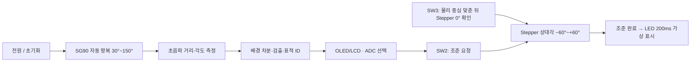

# MP_TerP — 최종 레이더 시스템 개발 브랜치

**브랜치:** `final/radar-system-20261126` (2026-11-26 분기)  
**기존 테스트 환경:** [`jun_GPT`](https://github.com/ulhannnah/MP_TerP/tree/jun_GPT) — 수정 없이 보존  
**상세 설명:** [20261126_최종_레이더_브랜치_동작구조_및_검증.md](docs/20261126_최종_레이더_브랜치_동작구조_및_검증.md)

## 실행 흐름



## 현재 기본 동작 — 2가지 모드 (2026-11-26 수정)

| 빌드 조건 | Servo | 초음파 | Tracker/Stepper/LED | 진단 |
|---|---|---|---|---|
| **기본 빌드 (결합 확인 심볼 없음)** | 자동 30~150° 왕복 | 고정 방향 Echo 거리 수집 | **2D 추적과 조준·LED 모두 비활성** | OLED에 `FIXED SENSOR`, LCD에 `FIXED 1D / NO ID` 표시 |
| 센서와 SG90의 방향 결합을 실제 확인 후 `MP_TERP_CONFIRM_COUPLED_GEOMETRY` 명시 | 자동 30~150° 왕복 | 실제 Servo 관측 방향에 따른 Echo | 정상 표적 ID/ADC/SW2 조준/SW3 Home | 레이더 화면 표시 |

**이제 심볼이 없다고 오류 50으로 멈추지 않는다.** 고정 센서의 거리에 서보의 명령 각도를 붙여 가짜 표적을 만드는 대신, **Servo와 1D 거리 센서의 개별 동작을 자동으로 보여주는 최종 모드 내 진단 경로**로 시작한다. 초음파 센서가 실제로 서보와 함께 회전하지 않으면 `MP_TERP_CONFIRM_COUPLED_GEOMETRY`를 정의하지 말 것.

디버거 Expressions: `g_stage_state=2`, `g_stage_error=0`, `g_stage_geometry_mode=0`이면 진단 모드 정상. `g_stage_scan_command_mdeg`가 30000~150000 사이를 왕복하고 `g_stage_fixed_echo_samples`가 증가하는지 본다. `g_stage_fixed_echo_valid`와 `g_stage_fixed_echo_mm`은 각각 최근 Echo 유효 여부와 고정 방향 거리다. **가상 거리 값이 아니라 실제 Echo 입력을 사용**한다. 정상 2D 모드에서는 `g_stage_geometry_mode=1`이다.

> 기계적 가동 범위/간섭·전원을 점검한 뒤 플래시할 것. Servo 실제 각도는 아직 측정·보정되지 않았으며, S32DS 빌드·실물 시험은 최신 변경 코드에서 아직 미검증이다.

## 새 브랜치 받아오기

```powershell
cd D:\WorkSpace\MP_TerP
git fetch origin
git switch -c final/radar-system-20261126 --track origin/final/radar-system-20261126
```

이미 로컬 브랜치가 존재한다면 `git switch final/radar-system-20261126` 후 `git pull --ff-only`를 실행하세요.

기존 SW2/Stepper·SW3/Servo 단독 테스트로 돌아가려면:

```powershell
git switch jun_GPT
```

최종 브랜치에서도 S32DS Symbols에 `MP_TERP_ALL_TEST_MAIN`만 명시해 기존 Bring-up을 실행할 수 있습니다. 최종 모드로 돌아갈 때는 해당 심볼을 제거합니다.

## 보드 없이 실행 가능한 검증

```bash
bash tests/run_host_tests.sh
bash tests/run_stepper_tests.sh
bash tests/run_servo_tests.sh
bash tests/run_pipeline_tests.sh
bash tests/run_integration_tests.sh
bash tests/run_profile_tests.sh
bash tests/run_lcd_async_tests.sh
bash tests/run_final_entry_tests.sh
bash tests/run_final_runtime_tests.sh
```

[GitHub Actions 자동 C 테스트 PASS (진단 모드 포함)](https://github.com/ulhannnah/MP_TerP/actions/runs/45769687201) — 합성 센서·모의 모터 기반 **호스트 소프트웨어** 검증만 의미합니다.

## 확인 전까지 남는 항목

- S32DS ARM 컴파일/링크, 실제 보드 핀/인터럽트, Watchdog 동작
- SG90 5점 실각도 보정, 초음파 센서-서보 실제 방향 정합
- SW3 기계적 중심 설정과 SW2 Stepper 조준의 실제 이동각
- 3개 표적 동시 검출, 표시 지연, 타임아웃 안전 동작의 실물 측정
