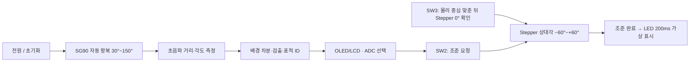

# MP_TerP — 최종 레이더 시스템 개발 브랜치

**브랜치:** `final/radar-system-20261126` (2026-11-26 분기)  
**기존 테스트 환경:** [`jun_GPT`](https://github.com/ulhannnah/MP_TerP/tree/jun_GPT) — 수정 없이 보존  
**상세 설명:** [20261126_최종_레이더_브랜치_동작구조_및_검증.md](docs/20261126_최종_레이더_브랜치_동작구조_및_검증.md)

## 실행 흐름



**중요:** 초음파 센서가 SG90에 기계적으로 결합되지 않은 상태에서 `MP_TERP_CONFIRM_COUPLED_GEOMETRY`를 켜면 안 됩니다. 이 심볼이 없으면 자동 레이더는 **`g_stage_error=50`으로 시작을 차단**합니다. 실제 조립을 확인한 후에만 S32DS에 해당 심볼을 추가하세요. 현재 기본 모드가 Stage 5인 것은 소스 선택에 관한 것이며, 실물 구동 허가가 자동으로 주어지는 것은 아닙니다.

## 새 브랜치 받아오기

```powershell
cd D:\WorkSpace\MP_TerP
git fetch origin
git switch -c final/radar-system-20261126 --track origin/final/radar-system-20261126
```

이미 로컬 브랜치가 존재한다면 `git switch final/radar-system-20261126` 후 `git pull --ff-only`를 실행하세요.

기존 SW2/Stepper·SW3/Servo 단독 테스트로 돌아가려면:

```powershell
git switch jun_GPT
```

최종 브랜치에서도 S32DS Symbols에 `MP_TERP_ALL_TEST_MAIN`만 명시해 기존 Bring-up을 실행할 수 있습니다. 최종 모드로 돌아갈 때는 해당 심볼을 제거합니다.

## 보드 없이 실행 가능한 검증

```bash
bash tests/run_host_tests.sh
bash tests/run_stepper_tests.sh
bash tests/run_servo_tests.sh
bash tests/run_pipeline_tests.sh
bash tests/run_integration_tests.sh
bash tests/run_profile_tests.sh
bash tests/run_lcd_async_tests.sh
bash tests/run_final_entry_tests.sh
bash tests/run_final_runtime_tests.sh
```

[GitHub Actions 자동 C 테스트 PASS](https://github.com/ulhannnah/MP_TerP/actions/runs/45767881240) — 합성 센서·모의 모터 기반 **호스트 소프트웨어** 검증만 의미합니다.

## 확인 전까지 남는 항목

- S32DS ARM 컴파일/링크, 실제 보드 핀/인터럽트, Watchdog 동작
- SG90 5점 실각도 보정, 초음파 센서-서보 실제 방향 정합
- SW3 기계적 중심 설정과 SW2 Stepper 조준의 실제 이동각
- 3개 표적 동시 검출, 표시 지연, 타임아웃 안전 동작의 실물 측정
