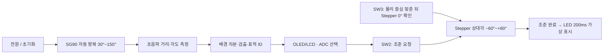

# MP_TerP — 최종 레이더 시스템 개발 브랜치

**브랜치:** `final/radar-system-20261126` (2026-11-26 분기)  
**외부 제어 변경:** [PTC4/PTC5 두 버튼·PTB0 ADC·PTE0 릴레이 핀맵과 시험 절차](docs/20261126_외부버튼_ADC_스텝조준_릴레이_GPIO_통합.md)  
**기존 테스트 환경:** [`jun_GPT`](https://github.com/ulhannnah/MP_TerP/tree/jun_GPT) — 수정 없이 보존  
**상세 설명:** [20261126_최종_레이더_브랜치_동작구조_및_검증.md](docs/20261126_최종_레이더_브랜치_동작구조_및_검증.md)

## 실행 흐름



## 최종 브랜치 외부 조작 (2026-11-26 최신)

| 기능 | 핀 / 커넥터 | 동작 |
|---|---|---|
| 외부 AIM 버튼 Active-Low | **PTC4 / J3-12** | Falling-Edge IRQ 플래그 → 35ms 디바운스 → Stepper 각도 명령 |
| 외부 RELAY 버튼 Active-Low | **PTC5 / J3-10** | 조준 완료 뒤에만 Relay 신호 1회 요청 |
| Relay 출력 Active-High | **PTE0 / J3-06** | 평소 LOW, 출력 허용 시 HIGH 200ms 후 LOW |
| 외부 가변저항 | **PTB0 / J4-05 / ADC0_SE4** | 1D에서는 수동 30~150° 각도, 결합된 2D에서는 표적 ID 1~3 |
| 버튼 공통 | **GND / J3-11** | Active-Low 스위치의 다른 단자 |

**기존 261125 Servo/Stepper/초음파/OLED/LCD 핀은 그대로**지만, 최종 Stage 5의 **버튼과 ADC 입력 핀은 변경**되었다. `jun_GPT` Bring-up 테스트의 SW2/SW3/PTC14 설정은 바꾸지 않았다.

### 물리 결합에 따른 동작

- **기본 빌드, 센서 고정(결합 확인 심볼 없음):** SG90은 자동 30~150° 왕복하고 초음파는 고정 방향 거리를 읽는다. 외부 Pot으로 선택한 **수동 방향**에 AIM 버튼으로 Stepper를 이동하고, 완료 후 RELAY 버튼으로 PTE0 제어 펄스를 낸다. 실제 2D 표적 ID는 생성하지 않는다.
- **실제 SG90-초음파 센서 결합 완료 후:** `MP_TERP_CONFIRM_COUPLED_GEOMETRY`를 명시하면 거리·각도 결합, 배경 차분, 표적 추적과 ADC ID 선택을 사용한다. AIM 버튼으로 선택 ID를 조준하고 RELAY 버튼으로 PTE0 신호를 낸다.

Stepper는 출력축 엔코더/홈 센서가 없으므로 **전원을 넣기 전에 기구적으로 중심 90° 방향에 맞춰 둔 현재 위치를 상대 0°로 간주**한다. 펌웨어가 물리적 원점을 찾아 주는 것은 아니다. 릴레이 GPIO는 **모듈 신호 입력** 전용이므로 코일을 직접 연결하지 말고, 최초 테스트는 부하 없이 수행한다.

S32DS Expressions: `g_stage_adc_raw`, `g_stage_adc_manual_angle_mdeg`, `g_stage_button_aim_count`, `g_stage_button_relay_count`, `g_stage_relay_armed`, `g_stage_relay_active`, `g_stage_relay_pulses`, `g_stage_error`.

[외부 핀 배선·ISR/메인 루프 구조·시험 순서 문서](docs/20261126_외부버튼_ADC_스텝조준_릴레이_GPIO_통합.md)

## 새 브랜치 받아오기

```powershell
cd D:\WorkSpace\MP_TerP
git fetch origin
git switch -c final/radar-system-20261126 --track origin/final/radar-system-20261126
```

이미 로컬 브랜치가 존재한다면 `git switch final/radar-system-20261126` 후 `git pull --ff-only`를 실행하세요.

기존 SW2/Stepper·SW3/Servo 단독 테스트로 돌아가려면:

```powershell
git switch jun_GPT
```

최종 브랜치에서도 S32DS Symbols에 `MP_TERP_ALL_TEST_MAIN`만 명시해 기존 Bring-up을 실행할 수 있습니다. 최종 모드로 돌아갈 때는 해당 심볼을 제거합니다.

## 보드 없이 실행 가능한 검증

```bash
bash tests/run_host_tests.sh
bash tests/run_stepper_tests.sh
bash tests/run_servo_tests.sh
bash tests/run_pipeline_tests.sh
bash tests/run_integration_tests.sh
bash tests/run_profile_tests.sh
bash tests/run_lcd_async_tests.sh
bash tests/run_final_entry_tests.sh
bash tests/run_final_runtime_tests.sh
bash tests/run_external_gpio_tests.sh
```

[GitHub Actions 자동 C 테스트 PASS (외부 GPIO/ADC/릴레이 포함)](https://github.com/ulhannnah/MP_TerP/actions/runs/45771817044) — 합성 센서·모의 모터 기반 **호스트 소프트웨어** 검증만 의미합니다.

## 확인 전까지 남는 항목

- S32DS ARM 컴파일/링크, 실제 보드 핀/인터럽트, Watchdog 동작
- SG90 5점 실각도 보정, 초음파 센서-서보 실제 방향 정합
- SW3 기계적 중심 설정과 SW2 Stepper 조준의 실제 이동각
- 3개 표적 동시 검출, 표시 지연, 타임아웃 안전 동작의 실물 측정
