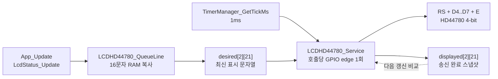
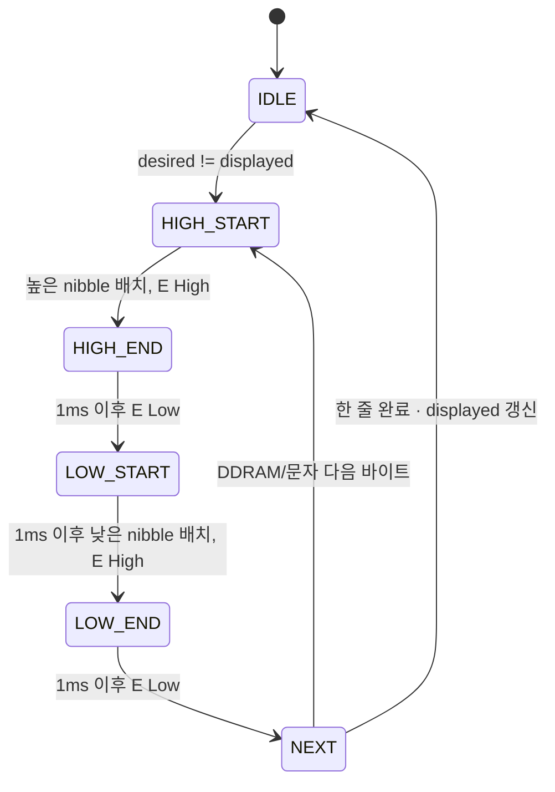

# 2026-11-25 HD44780 LCD 비차단 큐 전송 구조 및 PC CI 검증

> 프로젝트: `ulhannnah/MP_TerP` · S32K144EVB-Q100  
> 개발 브랜치: `jun_GPT`  
> 개발 상태: **Stage 5 LCD 런타임 비차단 경로 구현 / GCC 호스트 테스트 PASS / S32DS·실물 미검증**  
> CI: [GitHub Actions #45625610566](https://github.com/ulhannnah/MP_TerP/actions/runs/45625610566)  
> Bring-up 백업: `snapshot/20261125-peripheral-bringup`은 변경하지 않음

## 1. 문제 — 왜 LCD가 메인 루프를 막았는가

기존 HD44780 4-bit 드라이버는 `LCDHD44780_WriteLine()`에서 DDRAM 주소 명령 1개 + 16개 글자를 순차적으로 출력하며, 매 nibble의 E 신호에 `delay_us(2)`, `delay_us(50)` 호출을 사용한다.

그런데 실제 보드 템플릿의 `lcd_delay_us()`는 마이크로초를 밀리초로 올림한 다음 1ms LPIT Tick 기반 `delay_ms()`를 호출한다. 따라서 각 2μs/50μs 요청이 수 밀리초 Busy-wait가 될 수 있고, 글자 갱신 한 번이 긴 **foreground blocking 구간**으로 변한다. 다른 인터럽트의 하드웨어 타임스탬프 자체가 아니라, `App_Update` 반복 호출·초음파 읽기·표적 갱신이 지연될 수 있다는 문제가 있었다.

## 2. 이번 해결 방향

**초기 LCD 전원인가 설정은 기존 Blocking 호출을 보존하고, 운용 중 LCD 전송만 큐/상태 머신으로 변경.**

- `QueueLine`: 16글자 문자열을 RAM에 복사하고 즉시 반환, GPIO·지연 호출을 하지 않음.
- `Service`: 현재 Tick이 다음 단계 시각에 도달했으면 GPIO edge를 딱 한 번 처리; 바쁜 대기 또는 `delay_us` 호출 없음.
- `desired`는 최신 내용이며 `active_line`은 송신 중인 불변 스냅샷. 중간에 텍스트가 바뀌면 **현재 한 줄 송신 종료 후 최신 내용을 다시 송신**.
- `displayed`는 실제 LCD 픽셀 피드백이 아니라 **송신 완료됐다고 소프트웨어에서 기록한 문자열**임.
- `LCDHD44780_WriteLine`, `LCDHD44780_Init`은 기존 독립 Bring-up 호환을 위해 유지.

### 2.1 HD44780 nibble FSM

운용 중 Clear/Home 명령을 반복 사용하지 않고 DDRAM 주소 설정 1바이트 + 글자 16바이트를 전송하므로, HD44780의 일반 문자 쓰기에 필요한 내부 처리 간격을 충분히 확보하도록 1ms 단위로 분리했다. 실제 데이터/Enable 파형의 전기적 타이밍은 기판에서 오실로스코프로 확인해야 한다.

## 3. 적용 범위 — Stage 5에서만 Async

| 실행 경로 | 전송 방식 | 변경 여부 |
|---|---|---|
| 기본 `MP_TERP_ALL_TEST_MAIN` | 기존 `LCDHD44780_WriteLine` 동기 호출 | 유지 |
| `MP_TERP_STAGE_MAIN` + `MP_TERP_STAGE=5` | `LCDHD44780_QueueLine` + `BoardSystem_Update`에서 `LCDHD44780_Service` | 변경 |
| Stage 4 가상 센서 | 실제 LCD 미사용 | 기존대로 |
| LCD 초기화 `LCDHD44780_Init` | 기존 타이밍/대기 기반 초기화 | 유지, **부팅 시 Blocking 존재** |

연결 파일:
- `src/header/lcd_hd44780.h`, `src/lcd_hd44780.c`: 큐/상태 머신 및 디버그 필드.
- `src/header/board_system.h`: 선택적 `lcd_service` 콜백.
- `src/board_config_user_template.c`: Stage 5에서만 `lcd_write=LCDHD44780_QueueLine` 및 `lcd_service` 연결.
- `src/board_system.c`: `App_Update` 후 LCD 서비스 1단계 호출.
- `tests/test_lcd_async.c`, `tests/lcd_mock/device_registers.h`, `tests/run_lcd_async_tests.sh`: 호스트 검증.
- `.github/workflows/host-tests.yml`: 자동 CI 단계 추가.

## 4. 예상 소프트웨어 타이밍 (실측 아님)

| 단계 | Tick 서비스 회수 | 의미 |
|---|---:|---|
| Nibble High 시작/종료 및 Low 시작/종료 | 바이트당 4회 | 각 호출은 즉시 반환 |
| 한 줄 16문자 + DDRAM 주소 | 17 × 4 = **68회** | 이상적 1ms 호출 간격에서 약 **68ms** |
| 두 줄 전체 갱신 | 2 × 68 = **136회** | 이상적 갱신 시간 약 **136ms** |
| 변경 없음 | 0회 | LCD GPIO 접근 없음 |

이는 느리지만 **스캔 및 사용자 입력 처리의 메인 루프를 송신 중 지속적으로 점유하지 않는 방식**이다. 실제 시간은 `BoardSystem_Update` 호출 빈도, OLED 갱신, IRQ, 다른 부하에 따라 늘어날 수 있다. 한 화면을 완성하는 총 벽시계 시간과 Main Loop가 한 번에 차단되는 시간은 구분해야 한다.

**전기적 주의:** 정상 호출 흐름에서 E High 폭은 대략 1ms이며 메인 루프 지연 시 더 길어질 수 있다. HD44780 호환 모듈에서 이 방식이 안정적으로 동작하는지 확인 전에는 **실물 검증 완료**로 표기하지 않는다. 향후 필요하면 마이크로초 타이머 또는 짧은 펄스/IRQ 스케줄러로 개선 가능하다.

## 5. 호스트 테스트 및 실제 결과

[통합 CI 성공 로그](https://github.com/ulhannnah/MP_TerP/actions/runs/45625610566)

| 시험 | 결과 |
|---|---|
| 기존 LCD Blocking 초기화/동기 WriteLine 호출 | PASS |
| `QueueLine` 유효성 및 메모리 복사 | PASS |
| 같은 1ms Tick 내 중복 전송 방지 | PASS |
| 송신 도중 최신 문자열 변경/재전송 | PASS |
| 2줄 전송 완료 및 스텝 수(각 68회) | PASS |
| 변동 없는 문자열에 대한 중복 전송 억제 | PASS |
| 32-bit Tick wrap 시 진행 | PASS |
| 런타임 `delay_us` 호출 수 증가 없음 | PASS |
| 기존 Timer, Stepper, Servo, Radar, App, Profile 테스트 | PASS |

**이 CI는 호스트의 GPIO 레지스터 모의 객체와 시간 모의 값만을 사용한다. S32DS ARM 빌드, 전기적 Enable/Echo 타이밍, LCD 글자 출력 실물 측정은 수행하지 않았다.**

### S32DS 실물 확인 시 디버깅 값

- `s_lcd.service_steps`: LCD GPIO edge 처리 횟수
- `s_lcd.completed_lines`: 완료된 문자열 줄 수
- `s_lcd.tx_active`, `s_lcd.active_row`, `s_lcd.phase`: 현재 전송 상태
- `s_lcd.desired[0/1]`, `s_lcd.displayed[0/1]`: 최신 목표 문자열 및 송신 완료 스냅샷

`s_lcd`는 `board_config_user_template.c`의 file-static 객체로, 디버거에서 해당 소스의 로컬 심볼을 기준으로 찾는다. 빌드 최적화 수준에 따라 직접 노출되지 않을 수 있다.

## 6. 보드 확보 시 검증 순서

1. 기존 `ALL_TEST` 펌웨어로 LCD가 정상 출력되는지 확인하여 회귀 여부 분리.
2. Stage 5는 **서보–초음파 센서가 물리적으로 같은 방향을 볼 때만** `MP_TERP_CONFIRM_COUPLED_GEOMETRY`를 켜서 시험한다.
3. HD44780 E 핀과 RS/D4~D7 데이터 전송 순서, 각 E High 폭을 오실로스코프로 관찰.
4. 화면 갱신 지연, 문자가 깨지거나 이전 내용이 잠시 표시되는 현상, 1ms Tick 누락 여부 확인.
5. OLED/I2C 전송과 함께 돌렸을 때의 실제 `App_Update` 실행 주기, Echo 샘플 누락, 표적 추적 반응을 수집.
6. 필요하면 1ms 한 nibble edge → 수십 마이크로초 기준 짧은 Enable 펄스/전송으로 개선.

## 7. 남은 구조적 과제

- **Stage 5 Watchdog 정책**: Bring-up과 같은 Watchdog 초기화 여부 및 실행 중 갱신 정책 미정.
- **Stepper 타임아웃 안전 처리**: Snapshot FSM Timeout에서 LED 표시만 차단하며 모터의 물리적 정지/전원 차단까지 보장하지 않음.
- **하드웨어 타이밍 검증**: LCD GPIO와 고정 Echo 경로, Servo 보정/실각도는 보드 확보 후 검증해야 함.

> 최종 판정: **HOST_TESTED_LCD_ASYNC_ARCHITECTURE**. 하드웨어 실측 검증 완료가 아니다.
