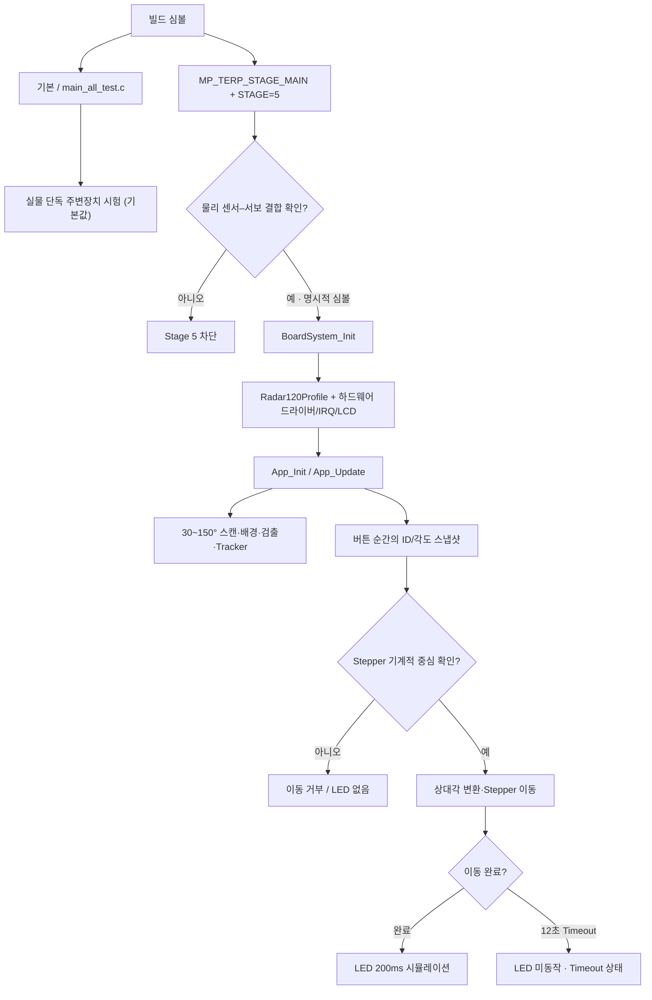
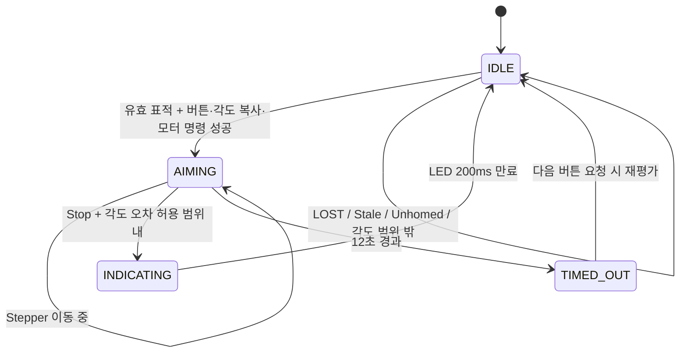

# 2026-11-25 Stage 5 App 통합 프로파일·좌표계·스냅샷 조준 FSM 구현

> 대상 프로젝트: MP_TerP / NXP S32K144EVB-Q100  
> 개발 브랜치: `jun_GPT`  
> 기능 구현 및 호스트 테스트 기준 커밋: `3f20bbf22fb5da147bd999156e60cb4c0f61c6d8`  
> CI: [GitHub Actions host-tests #45623538405](https://github.com/ulhannnah/MP_TerP/actions/runs/45623538405)  
> 상태: **PC GCC 기반 C 테스트 PASS / S32DS 빌드·보드 실기기 미검증**  
> Bring-up 보존 브랜치: `snapshot/20261125-peripheral-bringup` (미수정)

## 1. 이번 변경의 목적과 범위

이전 단계에서 전체 주변장치의 기본 단독 구동은 확인했지만, `main_all_test.c`는 레이더 앱을 실행하지 않는다. Stage 5 실물 전체 앱으로 전환하기 전 아래 소프트웨어 결함을 수정했다.

1. `BoardSystemConfig.application` 값이 0으로 남아 `App_Init`에 필요한 파라미터가 누락되던 문제.
2. RadarScan의 30~150° 절대 각도와 StepperController의 상대 0° 기준이 혼용되던 문제.
3. Stage 5 Echo/버튼 IRQ 벡터가 부착·활성화되지 않았던 문제.
4. LCD 드라이버를 초기화하지 않은 상태에서 통합 App이 `lcd_write`를 호출할 수 있던 문제.
5. 사용자의 버튼 누름 순간 조준 대상이 고정되지 않고 표적의 이후 위치 변화를 계속 따라가던 동작.

**변경하지 않은 것:** 기본 `main_all_test.c`의 SW2 Stepper·SW3 SG90 5점 검증 시퀀스, SG90 기초 보정 값, 주변장치 보존 브랜치. Stage 5의 실제 2D 스캔을 사용하려면 여전히 물리적 센서–서보 결합 확인이 필요하다.

## 2. 현재 실행 경로



실제 기판에서 이 흐름이 End-to-End 완료된 것은 아니다. 위 그림은 구현된 **의도된 소프트웨어 경로**다.

## 3. 120° Radar App 기본값

`src/header/app_profile.h`의 `MP_TERP_Radar120Profile()`에서 최종 App 비하드웨어 설정을 생성한다. `src/board_config_user_template.c`는 **Stage 5일 때만** 이 값을 `cfg->application`에 입력한다. 기존 Bring-up 펌웨어는 여전히 독립 시험 모드다.

| 그룹 | 소스 초기값 | 의미 |
|---|---|---|
| Scan | 30~150°, 5° 간격 | 25개 각도 bin |
| Servo settle | 80ms | 실제 정착 시간 실측 전 가정 |
| Echo Timeout | 35ms | 초음파 구동의 소프트웨어 상한 |
| DistanceFilter | Window 3 | 방향 bin별 평균 |
| Background | 차분 150mm | 표적 후보 판별 시작점 |
| Detector | 거리 차 250mm, 각도 gap 11°, 클러스터 2개 이상 | 근접 관측 군집화 |
| Tracker | 최대 각도차 20°, 거리차 500mm | 최근접 연관 |
| Target limit | 시연 3개 (최대 5개 저장) | 추적 슬롯 |
| Track LOST | 10,000ms 또는 miss 3회 | 스캔 재방문 주기에 따라 조정 |
| Target age limit | 8,000ms | 조준 신선도 |
| Display | OLED 150ms, LCD 300ms | **실시간성 보장 지표가 아닌 설정값** |
| LED | 200ms, 버튼 debounce 60ms | 가상 표시만 |
| Snapshot aim | ON, Timeout 12,000ms | 버튼 순간 캡처 |

실제 반왕복 스캔 시간은 `servo_settle+echo` 및 LCD/OLED Blocking 실행 시간에 따라 크게 달라진다. 이 값들은 **검증된 최종 파라미터가 아닌 시작점**이다.

## 4. RadarScan 각도 ↔ Stepper 상대각

실제 Stepper 구동기에는 절대 각도 센서가 없다. 센서–서보 스캔의 중심선 90°에 Stepper의 물리적 중심을 맞췄다는 사용자 확인이 필요하다.

```text
Radar absolute scan angle   Stepper relative angle
30°                        -60°
60°                        -30°
90°                          0°
120°                       +30°
150°                       +60°
```

`src/header/aim_geometry.h`의 `MP_TERP_AimToStepper()`와 `MP_TERP_StepperToAim()`로 양방향 변환한다. `BoardSystem`은 모터 명령 시 상대각으로 변환하고, `App`에 위치를 보고할 때 절대 스캔 각도로 복원한다. 두 변환은 int64 계산과 int32 오버플로 검사를 수행하며, 호스트 테스트로 검증했다.

**중요:** 상대 원점은 실제 홈 센싱이 아니다. Stage 5에서 `g_stage_stepper_center_confirm=0x484F4D45` 값을 명시적으로 입력해야 `BoardSystem_ConfirmStepperCenter`를 거쳐 현재 Stepper 위치를 상대 0°로 선언한다. **그 전에 기계적 중심과 출력축 방향을 직접 확인해야 한다.** 실제 방향이나 Stepper의 감속비가 잘못되면 명령각과 실각이 다를 수 있다.

## 5. 버튼 순간 조준 스냅샷 FSM



현재 `src/app.c`의 `fire_snapshot_mode=1`인 경우:

- `App_RequestFire` 시 선택 ID와 마지막 유효 표적 **명령 각도** 및 요청 시각을 저장한다.
- 이후 Tracker가 표적 각도를 갱신해도 **진행 중인 조준 명령을 변경하지 않는다**.
- Stepper 드라이버가 정지 상태이며 소프트웨어 계산 위치 오차가 허용값 내일 때만 LED를 켠다.
- 일정 시간 이내 도착하지 않으면 `APP_FIRE_TIMED_OUT`으로 처리하고 LED를 켜지 않는다.
- 기존 Stage 4·일부 테스트의 `fire_snapshot_mode=0`은 이전의 연속 추종 동작을 유지한다.

**한계:** Stepper는 엔코더가 없어 `aim_position`이 **내부 스텝 카운트로 추정한 위치**를 보고한다. LED가 켜지더라도 외부 기계적 도착 확인은 아니다. Timeout 시 MCU 코드가 표시를 차단하지만 이미 진행 중인 모터의 물리적 정지를 별도 명령하지는 않는다. 후속 안전 FSM 개선 사항이다.

## 6. IRQ / LCD Stage 5 구성

- Stage 5에 현재 보드 설정의 FTM0_CH6 Echo IRQ와 PORTC 버튼 IRQ 벡터를 추가했다. 초기화 완료 후 NVIC을 활성화한다.
- 설정된 실제 채널과 포트가 `FTM0_CH6` 및 `PORTC`가 아니면 Stage 5에서 Error 53으로 차단하도록 제한했다.
- `BoardSystemConfig.lcd_init` 콜백을 도입해, Stage 5의 `App_Init` 전에 HD44780 LCD를 초기화하도록 했다. 기본 Bring-up의 기존 `MP_TERP_AllTestLCDInit` 인터페이스도 유지한다.

**여전히 남은 부분:** `lcd_delay_us`는 현재 1ms Tick을 기반으로 반올림하여 Blocking 대기하므로 LCD 전체 업데이트 지연이 길어질 수 있다. 이번 변경은 **LCD 초기화 누락 문제만 해결**했으며, LCD 전송을 비차단화했다고 볼 수 없다. OLED 전송도 실제 보드 상의 지연 실측이 필요하다.

또한 Stage 5 진입의 WDOG 설정은 별도 검토가 필요하다. 현재의 Watchdog 비활성화 로직은 독립 Bring-up Main에만 있으므로 Stage 5에서 보드 동작을 보증하지 않는다.

## 7. PC 호스트 테스트 결과

[성공한 GitHub Actions 실행 보기](https://github.com/ulhannnah/MP_TerP/actions/runs/45623538405)

| CI 검사 항목 | 결과 |
|---|---|
| LPIT 타이머 테스트 | PASS |
| StepperController 테스트 | PASS |
| SG90 PWM + 5점 보간 테스트 | PASS |
| Radar Pipeline 테스트 | PASS |
| App 통합 테스트 | PASS |
| Stage 5 Profile + 각도변환/Overflow 테스트 | PASS |

`tests/test_integration.c`에서는 **버튼 시점 표적 각도 60° 저장 → Tracker의 표적 위치가 120°로 변해도 조준 명령은 60° 유지 → 위치 도달 후 LED → Timeout이면 LED 차단**을 모의 하드웨어 콜백으로 확인했다. 이는 실물 Stepper 정확도와는 별개의 C 로직 시험이다.

CI를 자동으로 실행하도록 `.github/workflows/host-tests.yml`에 `jun_GPT` 브랜치의 `src/**`, `tests/**` 변경 시 push trigger를 추가했다.

## 8. S32DS Stage 5 사용 조건 (지금은 실행하지 말 것)

보드 확보 및 실제 기구 결합 검증 후에만 아래 Symbols를 의도적으로 설정한다.

```text
MP_TERP_STAGE_MAIN
MP_TERP_STAGE=5
MP_TERP_USE_BOARD_CONFIG_TEMPLATE
MP_TERP_CONFIRM_PINMAP
MP_TERP_CONFIRM_COUPLED_GEOMETRY
```

Stage 5에서는 `MP_TERP_CONFIRM_COUPLED_GEOMETRY`를 정의하지 않으면 `g_stage_error=50`으로 동작을 차단한다. 이 플래그는 실제 방향 결합을 확인할 때만 사용해야 한다. 독립 장착 상태에서 소프트웨어 테스트를 위해 임의로 켜지 말 것.

## 9. 다음 소프트웨어/하드웨어 과제

1. **LCD 시간 지연 개선:** 인터럽트 기반 Echo 처리의 정확도에 영향을 주지 않도록 마이크로초 정밀 지연 또는 타임슬라이스 기반 화면 전송 구현. 보드에서 실제 속도/타이밍 검증.
2. **Stage 5 HW Build:** S32DS 코드 프로젝트에 모든 새 헤더와 수정 소스가 반영됐는지 확인. 컴파일·링크·Startup 벡터 충돌 여부 검사.
3. **WDOG / Fault 처리:** Stage 5 독립 Watchdog 정책, 안전한 Timeout 모터 정지 및 실패 상태 기록.
4. **기계적 방향 연동:** SG90-초음파 센서 일체형 고정/각도 5점 실측과 90° 기준선 정합.
5. **1→2→3개 표적 실물 검증:** 스캔 주기, 샘플 누락, ID Switch, 조준 및 LED 동작 시간 수집.
6. **정량 발표 자료:** 실물과 가상 데이터 성능 그래프 구분, 시스템 아키텍처 갱신.

본 기록은 소프트웨어 통합 경로에 대한 **현재 완료 범위**와 아직 보드가 필요해 남은 작업을 분리한 것이다.
