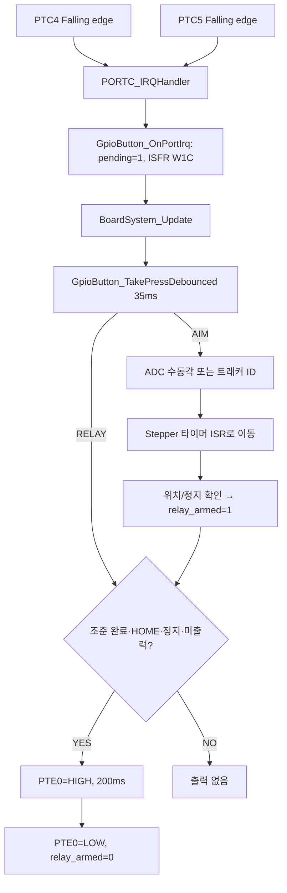

# 2026-11-26 외부 Active-Low 버튼·ADC 가변저항·Stepper·Relay GPIO 통합

> 프로젝트 `MP_TerP` / 개발 브랜치 `final/radar-system-20261126`  
> 마지막 실물 확인: **Servo 30~150° 자동 왕복 및 고정 초음파 Echo 거리, OLED/LCD 정상 출력**(이전 빌드)  
> 이번 변경: **외부 버튼/ADC/Relay 소프트웨어 구현 및 GCC Host CI PASS, 새 배선 실물 미확인**  
> 호스트 CI: [#45771817044](https://github.com/ulhannnah/MP_TerP/actions/runs/45771817044)

## 1. 요청 동작과 실물 통합

외부 스위치 2개는 모두 **Active-Low**(누를 때 0), 내부 Pull-Up 및 **PORTC Falling-Edge IRQ → ISR에서 플래그 설정 → 메인 루프에서 35ms 디바운스·플래그 폴링** 구조로 구현했다. ISR에서는 Stepper 이동/Relay 출력 함수를 호출하지 않는다.

| 입력/출력 | 실제 MCU 핀 | EVB 외부 헤더 | 동작 |
|---|---|---|---|
| 외부 AIM 버튼 | **PTC4** | **J3-12** | 목표각으로 Stepper 이동 명령 |
| 외부 RELAY 버튼 | **PTC5** | **J3-10** | 목표 위치 도달 후 Relay OUT에 단발 HIGH 펄스 |
| Relay 제어 신호 | **PTE0** | **J3-06** | **Active-High** / 기본 LOW / 200ms HIGH |
| 외부 가변저항 Wiper | **PTB0 / ADC0_SE4** | **J4-05** | ADC 0..4095로 선택 각도 또는 표적 ID 결정 |
| 버튼 공통 접지 | GND | **J3-11** 등 | 두 스위치의 다른 단자를 공통 GND로 |
| 가변저항 양끝 | VREFH 범위 전원 및 GND | 보드 전원/접지 헤더 | 전압은 반드시 ADC 참조 전압 이내 |

핀/헤더 배정 근거: [NXP S32K144 EVB 시작 가이드](https://www.nxp.com/document/guide/getting-started-with-the-s32k144evb%3ANGS-S32K144EVB), [S32K144 EVB 외부 헤더 핀맵](https://www.avnet.com/fsp/opasdata/d120001/medias/docus/190/NXP-S32K144EVB-Q100-Op-Instructions.pdf). PTB0의 ADC0_SE4 배정은 S32K144의 ADC interleave 기본 채널 매핑을 사용한다.

**기존 261125 모터·센서·디스플레이 핀은 유지**했으나, **최종 Stage 5 입력/출력 핀은 위 표와 같이 바뀌었다.** 이전 문서의 SW2 PTC12·SW3 PTC13·내장 Pot PTC14는 **기존 `jun_GPT` ALL_TEST 환경에만 그대로 남는다.**

### 하드웨어 주의사항

- Active-Low 스위치는 **PTC4 ↔ GND**, **PTC5 ↔ GND**로 연결. MCU 내부 Pull-Up 사용. 외부 스위치에 5V/12V를 직접 인가하지 않는다.
- 외부 가변저항 Wiper는 PTB0이며 **PTC14와 혼동하지 말 것**. 내장 가변저항은 PTC14에 남아 있다. 외부 Pot 양단 전원은 실제 EVB VREFH 및 전원 설정을 확인해 결정한다(ADC 입력 범위 초과 금지).
- PTE0은 **릴레이 코일에 직접 연결할 전력 출력이 아니라 로직 제어 GPIO**다. 릴레이 모듈 입력 또는 적절한 구동 트랜지스터·플라이백 다이오드/절연 회로의 입력으로만 연결한다.
- 릴레이 입력이 실제로 **High-Active**인지 확인해야 한다. 전원 투입 직후 모듈이 오동작하지 않도록 외부 Pulldown 및 릴레이 별도 전원/GND 구성을 확인한다.
- MCU 출력은 보드 공급 전압 도메인에 따르므로 릴레이 모듈의 입력 허용 전압과 접지 기준을 반드시 맞춘다. 모터의 전원은 MCU GPIO에서 직접 공급하지 않는다.
- Stepper에 원점 센서가 없어 **시작 전 출력축을 90° 중심에 손으로 맞춘 상태를 상대각 0°라고 선언**한다. 실제 절대 각도가 측정됐다는 뜻은 아니다.

## 2. Stage 5 동작 모드

### 기본 모드: 센서 고정 상태 (결합 확인 심볼 없음)

- SG90은 버튼 없이 30~150°를 자동 왕복.
- 초음파는 고정 방향 실제 거리값을 읽고 표시.
- 외부 Pot(PTB0)은 **수동 조준각 30~150°**를 선택. **이는 실제 초음파 표적의 각도가 아니다.**
- **AIM 버튼 PTC4**를 누르면 해당 수동 각도로 Stepper가 이동한다. Servo는 계속 스캔한다.
- 목표각에 소프트웨어 추정 위치가 도달하면 릴레이 제어 허용 상태로 전환.
- **RELAY 버튼 PTC5**를 누르면 PTE0 Active-High를 **200ms 한 번 출력** 후 LOW.
- 이 모드의 `TargetTracker`는 2D 대상 ID를 만들지 않는다.

### 결합 확인 후 2D 모드

센서가 SG90과 실제 같은 방향을 보도록 조립·영점을 확인했다면 `MP_TERP_CONFIRM_COUPLED_GEOMETRY` 심볼을 명시해 빌드한다.

- 초음파 측정값과 Servo 각도 결합, 배경 제거, 다중 표적 ID 추적.
- 외부 Pot(PTB0)은 **표적 ID 1~3 선택**.
- AIM 버튼으로 해당 ID 각도를 스냅샷하고 Stepper 이동.
- 이동 완료 시 기존 표시 LED가 200ms 점등하고, 외부 RELAY 버튼으로 별도 PTE0 제어 펄스를 출력한다.
- 대상이 없거나 신선하지 않으면 Stepper를 움직이지 않으며 릴레이 출력도 허용되지 않는다.

## 3. 입력·출력 인터럽트/플래그 처리



- **버튼 ISR**: 플래그만 세움. 인터럽트에서 시간 지연이나 GPIO 릴레이 변경을 하지 않음.
- **Foreground**: Debounce 중 active-low 핀 LOW 확인 후 한 번만 버튼 이벤트 발생, 이후 stable release까지 재무장하지 않음.
- **Relay 출력**: `GpioOutput_Init`에서 출력 모드로 전환하기 전에 출력 래치를 LOW 설정, 버튼 눌림이 지속돼도 1회 펄스만.
- **Interlock**: Stepper가 소프트웨어상 원점 확인되고 정지 중이며, 조준 완료 상태 전이로 1회 Arm 되었을 때만 펄스.
- **Timeout**: Stepper 조준이 12초를 넘기면 이동 중단 및 펄스 Arm 해제. 릴레이가 활성 중이었다면 즉시 LOW 요청.
- **한 번의 성공적인 조준 = 릴레이 허용 1회**. 새 펄스를 만들려면 AIM 버튼으로 다시 조준 완료해야 함.

## 4. 구현 파일과 CI

| 파일 | 변경 |
|---|---|
| `src/board_config_user_template.c` | 외부 PTC4/PTC5/PTB0/PTE0 핀 배치 및 타이밍 |
| `src/board_system.c` / `src/header/board_system.h` | ADC 아날로그 MUX0, 버튼 IRQ 이벤트 소비, 모터 Home/Relay 출력 관리 |
| `src/gpio_io.c` / `src/header/gpio_io.h` | IRQ 플래그 + 35ms Debounce, GPIO 활성/비활성 레벨 |
| `src/app.c` / `src/header/app.h` | 1D 모드의 ADC 수동각 선택과 Stepper 이동 |
| `src/header/relay_policy.h` | Relay 완료 상태 전이와 인터록/펄스 종료 조건 |
| `src/main_stage.c` | 기존 PTC12/PTC13 검증 조건을 PTC4/PTC5/PTB0/PTE0로 교체; Expressions 변수 |
| `tests/test_final_runtime.c` | 1D 수동 ADC 각도/Stepper/timeout 및 정상 2D 추적 회귀 |
| `tests/test_external_gpio.c` | Active-Low 버튼 디바운스, IRQ/출력, 200ms 펄스 게이트 |
| `.github/workflows/host-tests.yml` | 새 GPIO 테스트 CI 단계 |

[GitHub Actions Host CI PASS](https://github.com/ulhannnah/MP_TerP/actions/runs/45771817044). **호스트 모의 GPIO/ADC/Stepper 데이터 검증이며 실제 릴레이 구동이나 오실로스코프 PWM 실측은 아직 하지 않았다.**

## 5. S32DS 빌드 및 실물 점검

```powershell
cd D:\WorkSpace\MP_TerP
git switch final/radar-system-20261126
git pull --ff-only origin final/radar-system-20261126
```

S32DS에서 Clean → Build → Debug → Resume. `main_stage.c`가 `main()` 역할. `main.c`와 `main_all_test.c`에서 또 다른 Main이 활성화되지 않도록 설정한다.

### Debug Expressions

| 이름 | 정상 예시 또는 의미 |
|---|---|
| `g_stage_error` | 0 |
| `g_stage_state` | 2 = 실행 중 |
| `g_stage_tick_ms` | 지속 증가 |
| `g_stage_geometry_mode` | 0 = 수동 ADC/고정 센서, 1 = 진짜 결합 2D |
| `g_stage_adc_raw` | 0~4095, 외부 Pot을 돌리면 변함 |
| `g_stage_adc_manual_angle_mdeg` | 30000~150000 (1D 수동 모드) |
| `g_stage_button_aim_count` | PTC4 눌렀을 때 한 번 증가 |
| `g_stage_fire_state` | 0 idle / 1 aiming / 2 arrived / 3 timeout |
| `g_stage_button_relay_count` | PTC5 눌렀을 때 한 번 증가 |
| `g_stage_relay_armed` | 소프트웨어 조준 완료 후 1 |
| `g_stage_relay_active` | PTE0 HIGH 200ms 동안 1, 이후 0 |
| `g_stage_relay_pulses` | 성공적으로 출력된 펄스 횟수(눌렀다고 항상 증가하지 않음) |
| `g_stage_stepper_center_homed` | 1 = 부팅 시의 **소프트웨어 기준 선언**, 물리 Home 측정 아님 |

**안전한 첫 실물 확인 순서:** 릴레이 모듈은 연결하지 않은 상태에서 외부 Pot ADC 값 → AIM 버튼으로 Stepper 이동 → 릴레이 버튼을 누를 때 PTE0 HIGH 200ms를 LED/오실로스코프로 확인 → 별도 릴레이 입력 사양/전원 검증 후에만 모듈 연결.

## 6. 제한 사항과 검증 필요 항목

- 외부 스위치와 Pot의 실제 배선/전기레벨, ADC0_SE4의 동작, GPIO PTE0 펄스는 아직 보드에서 검증되지 않음.
- Stepper 실제 절대 각도는 내부 스텝 카운트 기반 추정이므로 기계적 0° 방향·감속비·탈조는 별도 측정 필요.
- 릴레이 Coil/접점에 어떤 실제 부하가 연결되는지는 코드로 알 수 없으므로 **로직 신호만 검증**, 고전압 부하 없이 시작할 것.
- Servo의 30~150°는 명령각이며 아직 실측 각도 보정 전.
- 기존 `jun_GPT`의 261125 Bring-up 핀 및 버튼 동작은 수정하지 않았음.
