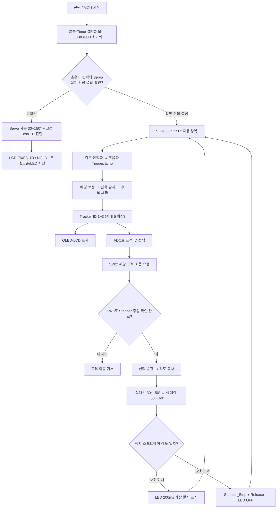

# 2026-11-26 MP_TerP 최종 레이더 애플리케이션 분기 및 검증

> **개발 브랜치:** `final/radar-system-20261126`  
> **보존된 주변장치 시험 환경:** `jun_GPT` (분기 기준 커밋 `3fc0eef3db65c57890a77771af4806fa8129a521`)  
> **기존 기준 스냅샷:** `snapshot/20261125-peripheral-bringup`  
> **검증:** [GitHub Actions #45769687201 — 호스트 C 테스트 전체 PASS (1D 진단 포함)](https://github.com/ulhannnah/MP_TerP/actions/runs/45769687201)  
> **범위:** 최종 소프트웨어 실행 경로 및 가상 센서 E2E 테스트 구현. S32DS ARM 빌드와 실제 모터/레이더 통합 실기기 검증은 아직 수행하지 않았다.

> **2026-11-26 실행 문제 해결:** 디버거에서 `g_stage_state=57005 (0xDEAD)`, `g_stage_error=50`으로 멈추던 상태를 해소했다. 최종 브랜치의 기본 설정은 이제 결합 미확인일 경우 **Servo 자동 왕복·고정 Echo 거리 측정 및 상태 표시**로 동작한다. `g_stage_geometry_mode=0`은 1D 진단, `1`은 사용자가 기구적 결합을 확인한 2D 모드. 새 진단 변수는 `g_stage_fixed_echo_samples`, `g_stage_fixed_echo_valid`, `g_stage_fixed_echo_mm`, `g_stage_scan_command_mdeg`이다. 1D 모드에는 실제 표적 ID가 생기지 않으므로 SW2 Stepper 조준/LED는 차단된다. `g_stage_error`가 51~55 등 다른 오류인 경우 해당 초기화 실패를 별도로 조사해야 한다.

## 1. 브랜치 구조

```text
jun_GPT  (2026-11-25 주변장치별 독립 구동 코드, 변경 없음)
   └── final/radar-system-20261126
       ├── 기본 Main = main_stage.c Stage 5
       ├── 자동 SG90 스캔 → Echo → 필터/검출/Tracker
       ├── ADC ID 선택 + SW2 조준 요청 → Stepper → LED
       ├── SW3 수동 Stepper 중심 확인 (원점 센서 아님)
       ├── 안전 타임아웃 정지
       └── 최종 실행 모드/가상 센서 전체 테스트
```

**중요:** `src/main_all_test.c`는 새 브랜치에도 남아 있으며 **강제로 선택하면 기존 SW2 Stepper 시험/SW3 Servo 시험**을 그대로 실행할 수 있다. 테스트 브랜치 `jun_GPT`의 HEAD는 건드리지 않는다.

## 2. 최종 시스템 동작 (설계 + C 코드)



**실제 초기화/스캔 시점:** 코드에서는 `App_Init()` 마지막의 `RadarScan_Start()`가 첫 30° 명령을 발행한다. 이후 Main Loop의 `BoardSystem_Update() → App_Update()`가 Servo를 연속 스캔한다. **Servo를 움직이기 위해 버튼을 누르지 않는다.** 물리 결합 검증이 없으면 Stage 5는 중단되지 않고 **고정 Echo 1D 진단 모드**로 동작한다. 이때 실제 2D 표적 검출·Stepper 조준은 비활성화된다.

**SW2 / SW3의 역할:** `SW2(PTC12)`는 선택 표적 조준 및 LED 표시 요청이고, `SW3(PTC13)`는 사용자가 기계적 중심 방향을 눈으로 맞춘 후 **Stepper 상대각 0°를 선언**하기 위한 일회성 입력이다. SW3를 눌러도 SG90을 시험 왕복시키지 않는다.

## 3. Pin map (2026-11-25 기준 변경 없음)

| 장치 | MCU 포트 | 주변장치 |
|---|---|---|
| SG90 Servo | PTD10 | FTM2 CH0 PWM |
| 초음파 Trigger / Echo | PTB8 / PTE8 | GPIO / FTM0 CH6 |
| Stepper 4상 | PTB9 / PTB10 / PTB11 / PTB5 | GPIO + LPIT CH0 |
| 시스템 Tick / Echo Trigger timer | 별도 핀 없음 | LPIT CH2 / CH1 |
| ADC Potentiometer | PTC14 | ADC0 SE12 |
| OLED SDA/SCL | PTA2 / PTA3 | LPI2C0 |
| HD44780 LCD RS/E | PTD4 / PTD5 | 4-bit GPIO |
| LCD D4~D7 | PTD11~PTD14 | GPIO |
| LED | PTD15 | 내장 RED |
| SW2 선택 표적 조준 | PTC12 | PORTC IRQ |
| SW3 Stepper 중심 확인 | PTC13 | PORTC IRQ |

[기준 핀맵 문서](20261125_현재_Main기준_IO핀_설정현황.md) · [기본 Bring-up 버전 코드](https://github.com/ulhannnah/MP_TerP/tree/jun_GPT)

## 4. 실행 모드와 빌드 설정

| 경우 | `project_config.h` 기본 또는 외부 Symbol | 동작 |
|---|---|---|
| **새 최종 브랜치에서 기본 빌드** | 다른 Main 심볼이 없으면 `MP_TERP_STAGE_MAIN` + `MP_TERP_STAGE=5` 자동 선택 | 센서 결합 미확인 시 1D 고정 Echo + 자동 Servo 진단 |
| **물리 결합 확인 후 최종 실행** | `MP_TERP_CONFIRM_COUPLED_GEOMETRY`를 S32DS Symbols에서 **명시적으로** 설정 | 실제 2D 스캔·표적 추적·조준 활성화 |
| **기존 전체 주변장치 시험** | `MP_TERP_ALL_TEST_MAIN`를 명시적으로 지정, Stage/Example 선택 심볼 제거 | SW2 100° Stepper 단발·SW3 5점 SG90 시험 |
| **가상 센서 Stage 4** | `MP_TERP_STAGE_MAIN` + `MP_TERP_STAGE=4` | 실제 하드웨어 대신 가상 Echo로 C 처리 테스트 |
| **Smoke** | `MP_TERP_SMOKE_MAIN` | 드라이버를 구동하지 않는 기본 연산 시험 |

최종 모드에서 `MP_TERP_CONFIRM_COUPLED_GEOMETRY`를 자동 정의하지 **않았다**. 결합 미확인 상태에서도 Servo·실제 Echo는 동작하지만, 고정 센서 측정에 가짜 스캔 각도를 부여하지 않으므로 2D Tracker/Stepper 조준/가상 발사는 동작하지 않는다. S32DS 프로젝트가 이전에 `-DMP_TERP_ALL_TEST_MAIN`을 직접 설정했다면 새 브랜치에서도 해당 심볼을 제거해야 최종 모드로 시작한다.

**실물에서 권장하는 확인 순서:**

1. S32DS 기존 빌드 옵션과 소스 경로를 확인한다. `main_stage.c`, `board_config_user_template.c`, `board_system.c`, `app.c`, 최근 추가 헤더가 모두 프로젝트에 포함됐는지 확인한다.
2. 초음파 센서가 SG90과 실제로 함께 회전하는지, 중심선과 30~150° 기구적 범위, 전원·공통 GND·Echo 전압 허용치를 검증한다.
3. 초음파 센서가 고정이라면 심볼 없이 재빌드하여 Servo와 1D 고정 Echo를 점검한다. 실제 결합 후에만 `MP_TERP_CONFIRM_COUPLED_GEOMETRY`를 추가하여 2D 모드를 실행한다.
4. Servo 자동 스캔과 초음파·표적 ID 출력을 먼저 확인한다. Stepper 방향을 90° 중심으로 물리적으로 맞춘 후 **SW3 한 번**을 누른다. 이 동작은 **진짜 Home 센싱이 아니다**.
5. ADC로 유효한 표적 ID를 선택하고 SW2를 눌러 Stepper가 방향을 맞추는지, 조준 완료 시 LED가 짧게 켜지는지 확인한다.
6. S32DS Expression에서 `g_stage_scan_command_mdeg`, `g_stage_frames`, `g_stage_candidates`, `g_stage_selected_id`, `g_stage_stepper_center_homed`, `g_stage_fire_state`, `g_stage_error`를 확인한다.

**Stage 5 에러코드:** `50`은 이전 버전의 결합 가드 오류로, 최신 소스에서는 발생시키지 않는다. `51` 보드 프로파일 취득 실패, `52` BoardSystem/App 초기화 실패, `53` 예상한 FTM0 CH6/PORTC SW2·SW3 배치와 불일치, `54` 디버거의 수동 Home 시도 실패, `55` WDOG disable 실패.

## 5. 최종 브랜치에서 추가·수정한 코드

| 파일 | 변경 |
|---|---|
| `src/header/project_config.h` | 최종 브랜치 기본 Main=Stage 5, ALL_TEST 오버라이드 유지 |
| `src/header/board_system.h`, `src/board_system.c` | 홈 확인용 SW3·두 버튼 IRQ 처리·Stepper timeout stop/release |
| `src/board_config_user_template.c` | PTC12 SW2 조준, PTC13 SW3 중심 확인 연결, 기존 핀 번호 유지 |
| `src/main_stage.c` | Stage 5 WDOG 초기화, 채널/버튼 맵 검증, 상태 진단 변수 |
| `src/header/app.h`, `src/app.c` | Snapshot 모드에 `aim_stop` 필수, 12초 timeout에 Stepper 정지 요청 |
| `tests/test_integration.c` | 실제 코드의 timeout motor stop callback과 fail-closed 검증 |
| `tests/test_final_entry.c` | Stage 5 기본 실행 및 ALL_TEST 선택과 물리 결합 가드 검증 |
| `tests/test_final_runtime.c` | 자동 스캔·배경 학습·합성 표적 ID·SW2 조준·LED E2E 가상 시나리오 |

보드 초기화에서 WDOG 비활성화는 기존 Bring-up과 동일한 S32K144 시퀀스를 사용한다. **대학교 시연을 위한 임시 정책**이며, 실사용 제품의 Watchdog 정책으로 적합하다고 주장할 수 없다.

## 6. 실제 GitHub Actions 검증

[2026-11-26 최신 Host CI 실행 로그](https://github.com/ulhannnah/MP_TerP/actions/runs/45769687201)

| 호스트 테스트 | 결과 |
|---|---|
| 타이머 / LPIT | PASS |
| Stepper Controller | PASS |
| Servo PWM / 5점 보간 | PASS |
| Radar Pipeline | PASS |
| App 모의 통합 / Snapshot FSM Timeout 정지 | PASS |
| Stage5 Profile / Radar–Stepper 좌표계 | PASS |
| LCD 비차단 FIFO/상태 머신 | PASS |
| **최종 기본 Main 선택 / ALL_TEST 보존** | **PASS** |
| **최종 C App 자동 스캔 → 배경 → 표적 → SW3 Home Guard → SW2 조준 → LED** | **PASS** |
| **결합 미확인 1D 모드 → 자동 Servo + 실제 Echo 콜백, 표적/조준/LED 차단** | **PASS** |

모의 데이터는 배경 거리 3m를 기반으로, 특정 각도 구간에서 단거리 표적 Echo를 생성한다. 실제 모터의 기계적 회전각/전류, 초음파 전자기·기구 오차, S32DS 컴파일/링크는 이 호스트 테스트가 입증하지 못한다.

## 7. 남은 작업과 개발 판정

- [x] 원본 주변장치 시험 브랜치 보존
- [x] 전용 최종 시스템 브랜치 생성
- [x] Stage 5 기본 선택 및 자동 스캔 호출 경로
- [x] SW2 조준/SW3 수동 중심 입력 분리
- [x] 동작 중 Stepper 타임아웃 정지·코일 해제 명령
- [x] GCC 호스트 테스트, 최종 통합 가상 시나리오 PASS
- [ ] S32DS ARM 컴파일·링크 및 실제 런타임 확인
- [ ] 실제 SG90 5점 각도 보정 및 30~150° 안정 스캔
- [ ] 초음파 센서의 서보 기구 방향 결합 및 타임스탬프 정합
- [ ] Stepper 기준 방향과 실제 60° 상대 이동의 기구 검증
- [ ] 실물 1/2/3 표적 검출·추적/표시·조준·LED 지연 측정
- [ ] 실제 LCD E/데이터 전송 타이밍 검증 및 전원/Watchdog 복원 검토

**최종 판정: `FINAL_BRANCH_HOST_E2E_PASS + UNCOUPLED_1D_DIAGNOSTIC_PASS / BOARD_NOT_VERIFIED`.** 개발용 최종 시스템 경로는 완성하고 보존했지만, 실제 보드 통합이 완료됐다고 표시해서는 안 된다.
