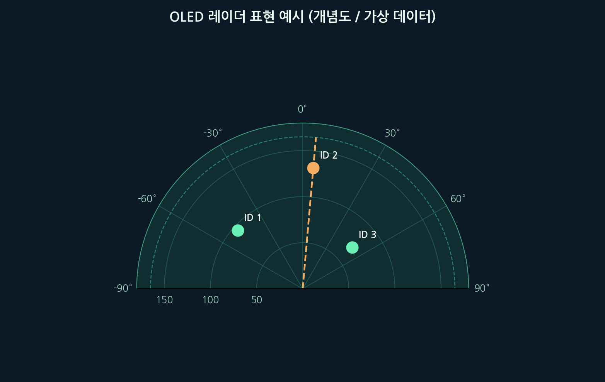
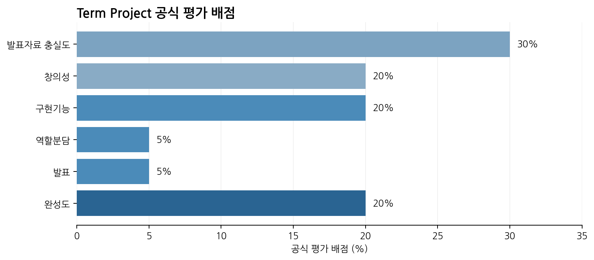
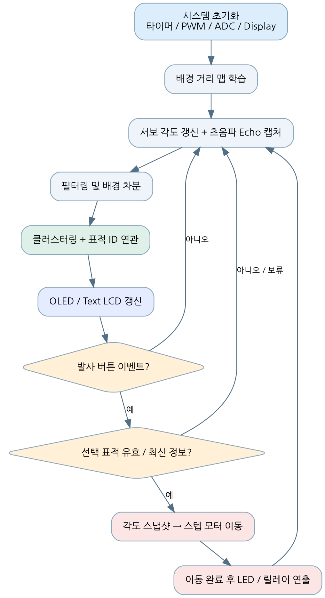
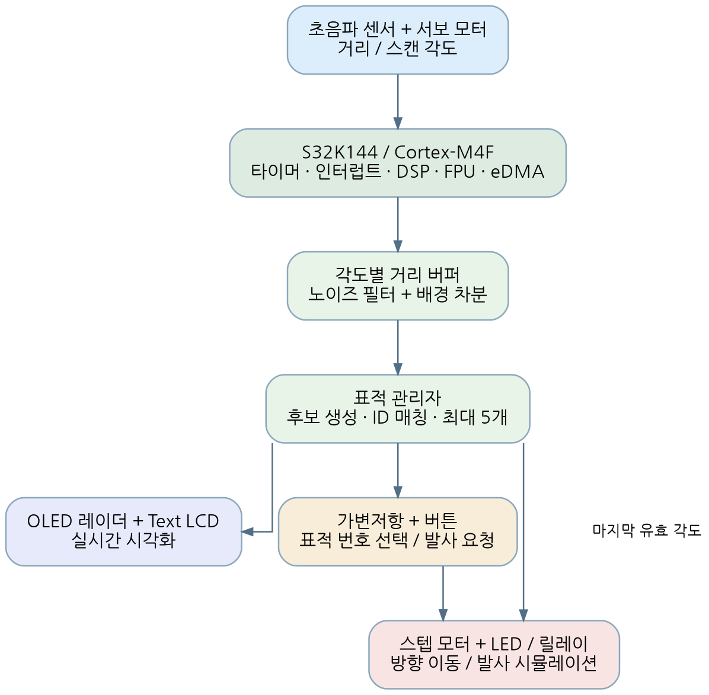

# 마이크로프로세서 설계실험 텀프로젝트 종합 설계 및 평가

> **프로젝트명(가칭)**: Cortex-M4F 기반 실시간 다중 표적 탐지·추적 및 방공 시뮬레이션 시스템  
> **영문명**: Real-Time Multi-Target Tracking and Defense Simulation Using ARM Cortex-M4F  
> **대상**: NXP S32K144EVB 및 수업 실습 보드  
> **정리 기준일**: 2026-11-19  
> **최종 발표**: 2026-12-16(수), 팀별 10분  
> **주의**: 실제 발사 장치를 제작하지 않고, 스텝 모터 방향 표시 및 LED/릴레이로 **발사 동작을 시뮬레이션**한다.

## 1. 프로젝트 목적 및 핵심 기여

서보 모터로 회전하는 초음파 센서가 주변 거리를 각도별로 측정한다. MCU는 스캔 결과를 배경 거리 맵과 비교해 변화 영역을 찾고, 여러 관측값을 물체 후보로 묶은 뒤 최대 5개 표적의 ID·각도·거리·속도·추적 상태를 관리한다. 사용자가 가변저항으로 표적 번호를 선택하고 발사 버튼을 누르면 **버튼 순간에 저장된 해당 표적의 마지막 유효 각도**를 기준으로 스텝 모터가 이동한다. 이동 완료 시 LED/릴레이로 가상 발사 상태를 표현한다.

**차별점**은 초음파 레이더 화면 자체보다 다음 기능의 결합에 있다.

1. 정적 배경 억제 및 이동 표적 후보 생성
2. 스캔 간 관측값 연결(Data Association)과 최대 5개 고유 ID 관리
3. Cortex-M4F의 DSP 명령어 및 FPU 활용
4. FTM·ADC·타이머·인터럽트·디스플레이의 비차단식 통합 제어
5. 선택 표적 데이터의 시각화 및 방향 구동 장치 연동
6. 일반 C / DSP / FPU / DMA 등의 **실측 성능 비교**

> **용어 주의**: 실제 레이더는 정지 물체도 탐지할 수 있다. MTI/도플러 레이더에서 정적 클러터를 억제하는 원리를 참고하되, 이 프로젝트는 *초음파 스캔 간 거리 변화*로 이를 모사한다. 도플러 레이더를 구현했다고 표현하지 않는다.

## 2. 시스템 전체 구성



*그림 1. 초음파 스캔 입력부터 표적 추적, 표시, 방향 제어까지의 개념적 데이터 흐름. 실제 핀·DMA 매핑은 별도 확인 필요.*

### 입출력 역할

| 모듈 | 사용 목적 | 예정 MCU 기능 | 중요도 |
|---|---|---|---|
| 초음파 센서 | Echo 펄스 폭으로 거리 산출 | GPIO, 타이머 Input Capture | 필수 |
| 서보 모터 | 초음파 센서의 방향 스캔 | FTM PWM | 필수 |
| 스텝 모터 및 드라이버 | 선택 각도 방향 이동 | GPIO, 주기 타이머 | 필수 |
| OLED | 레이더 방사형 화면, 표적 ID | LPSPI 또는 LPI2C | 필수 |
| Text LCD | 선택 ID, 거리, 각도, 상태 | GPIO 또는 I2C 등 | 필수 |
| 가변저항 | 표적 ID 1~5 선택 | ADC | 필수 |
| 버튼 | 가상 발사 요청 | GPIO, NVIC 인터럽트 | 필수 |
| LED/릴레이 | 가상 발사 결과 표현 | GPIO (릴레이는 드라이버 필요) | 필수 |
| DSP 명령어 | 고정소수점 거리 필터 연산 | Cortex-M4 DSP 확장 | 핵심 |
| FPU | 좌표·속도·예측 계산 | 단정밀도 FPU | 핵심 |
| eDMA | 지원되는 주변장치 데이터 전송 | eDMA + LPSPI 등 | 선택 확장 |
| LPIT / DWT | 주기 이벤트 / 사이클 측정 | 하드웨어 타이머 / DWT | 핵심/검증 |
| WDOG / PDB | 비정상 동작 관리 / ADC 트리거 | 칩 주변장치 | 선택 확장 |

**설계 전 확인할 사항:** 실제 실습 보드 핀 배치, 서보·스텝 모터 구동 전원, 모터 드라이버, OLED 및 LCD의 인터페이스, 각 FTM 채널과 DMA 요청 매핑. 표의 주변장치는 후보이며 모든 자원 배치가 완료된 상태는 아니다.

## 3. 주요 동작 시나리오

1. **초기화:** PWM, ADC, Input Capture, 타이머, 디스플레이, 버튼 인터럽트를 설정한다.
2. **배경 학습:** 표적이 없는 상태에서 0~180° 구간을 여러 번 스캔해 각도별 배경 거리 `B[i]`를 생성한다.
3. **반복 스캔:** 서보 위치를 바꾸고 안정화 후 초음파 Echo 시간을 측정해 `(각도, 거리, 시각)`을 버퍼에 저장한다.
4. **전처리:** 센서 노이즈를 줄이고 배경 맵과 차이가 나는 측정값을 찾는다.
5. **관측값 생성:** 인접 각도에서 나온 응답을 하나의 물체 후보로 묶는다.
6. **표적 ID 추적:** 최대 5개 기존 트랙과 새 후보를 연관시키고 `NEW/TRACKING/LOST` 등의 상태를 관리한다.
7. **표시:** OLED에 레이더 화면과 ID를 표시하고, Text LCD에 선택 표적 정보를 출력한다.
8. **선택:** 가변저항을 ADC로 읽어 표적 번호를 선택한다.
9. **가상 발사:** 버튼을 누르면 선택 표적의 데이터 유효성을 확인하고, 그 순간의 마지막 유효 각도를 **스냅샷으로 고정**한다. 스텝 모터 이동 완료 후 LED/릴레이로 결과를 표현한다.
10. **상시 운용:** 서보 스캔 및 표적 데이터 갱신은 가능한 한 계속 수행하되, 구동 부하와 전원 간섭을 검사한다.



*그림 2. 초기화, 배경 학습, 탐지, 추적, 사용자 이벤트, 가상 발사의 전체 흐름.*

## 4. 디스플레이 출력 예시


*그림 3. 가상 관측 데이터로 만든 레이더 화면 개념도. 실제 OLED의 해상도(예: 128×64)에 맞춰 단순화해야 한다.*

- **OLED:** 반원형 거리 눈금, 현재 스캔 방향, 탐지 표적 ID, 선택 ID 강조
- **Text LCD:** 선택된 표적의 `ID / ANGLE / DIST / STATUS` 순환 또는 페이지 표시
- **시연 방법:** 고정 물체가 있는 배경에서 움직이는 반사체를 추가하고 탐지/추적 변화를 관찰한다.

## 5. 표적 탐지 및 추적 알고리즘

### 5.1 초음파 거리 측정

\[
d=\frac{c\,\Delta t_{echo}}{2}
\]

여기서 `c`는 음속, `Δt_echo`는 초음파 왕복 시간이다. 타이머 캡처값과 온도·타이머 해상도에 따른 오차를 고려한다.

**스캔 설계 예:** 0~180°를 5° 간격으로 측정하면 37개의 각도가 생성된다. 측정 위치마다 40 ms가 소요된다고 *가정*하면 편도 1.48초, 왕복은 끝점 중복을 제외하여 약 2.9초다. 이는 실측값이 아니며 센서와 서보 모터의 응답에 의해 달라진다.

### 5.2 배경 제거

각도별 배경 거리 `B[i]`와 관측값 `d[i]`를 비교한다.

\[
\Delta d_i=|d_i-B_i|,\qquad \Delta d_i > T_d\Rightarrow \text{변화 후보}
\]

차이가 있다는 사실만으로 이동 표적이라고 확정하지 않는다. 새로 설치된 정지 물체도 차이를 만들 수 있으므로 **연속 스캔에서 위치 변화**를 확인해야 한다. 초기 단계에서는 배경 맵을 고정하고, 재학습 버튼 또는 별도 모드에서 갱신한다.

### 5.3 물체 후보 생성

인접 각도에서 비슷한 거리로 반복 관측된 샘플들을 클러스터로 묶는다. 넓은 초음파 빔에 의해 하나의 물체가 여러 각도에서 탐지될 수 있으므로, **샘플 수 = 물체 수**로 간주하지 않는다.

### 5.4 최대 5개 표적의 ID 유지

| 필드 | 예시 자료형 | 의미 |
|---|---|---|
| `id` | `uint8_t` | 표시용 고유 ID 1~5 |
| `x, y` | `float` | 최근 위치 추정 |
| `vx, vy` | `float` | 속도 추정 |
| `angle, range` | `float` | 최근 측정 각도/거리 |
| `last_seen_ms` | `uint32_t` | 마지막 관측 시각 |
| `state` | `enum` | `EMPTY / NEW / TRACKING / LOST` |
| `miss_count` | `uint8_t` | 연속 관측 실패 횟수 |

관측값을 극좌표에서 평면 좌표로 변환한다. 본 문서에서는 서보의 정면을 0°로 정의한 예시를 사용한다.

\[
x=r\sin\theta,\qquad y=r\cos\theta
\]

초기 예측은 가속도 없이 등속도 모델로 구성한다.

\[
\hat{\mathbf p}(t+\Delta t)=\mathbf p(t)+\mathbf v(t)\Delta t
\]

기존 표적과 새 관측값 간의 **제곱 유클리드 거리**를 계산해 허용 이동 거리 안의 쌍을 찾는다. 5개 표적 × 5개 관측이면 25개 후보 쌍이므로 연산량보다 **초음파 스캔 시간 및 관측 품질**이 더 큰 제약일 수 있다. 모든 관측과 표적을 일대일로 연결하고, 애매한 경우에는 ID 확정 대신 추적 불확실 상태로 남긴다.

- **신규 생성:** 기존 트랙과 연결되지 않은 후보가 연속 확인되면 ID 부여
- **추적 유지:** 잠깐 이동을 멈춘 물체도 즉시 삭제하지 않음
- **LOST 처리:** 일정 스캔 수 또는 일정 시간 동안 관측이 없으면 상실 처리
- **재탐지:** 위치·시간 조건이 충분할 때만 기존 ID와 다시 연결
- **교차 시나리오:** 초음파 측정만으로 ID를 항상 정확히 복구할 수는 없음

### 5.5 발사 이벤트 데이터 처리

`fire_request`가 발생한 시점에 선택 표적 ID, `last_seen_ms`, 상태와 측정 각도를 확인한다. **타임스탬프가 오래되거나 트랙이 LOST라면 동작을 보류**한다. 유효한 경우 해당 각도를 복사해 조준 대상으로 고정한다. 이후 추적 테이블 값이 변경되어도 현재 스텝 모터의 조준 명령은 변하지 않는다. 실제 발사체 구동은 포함하지 않는다.

## 6. Cortex-M4F 내부 기능의 활용

### 6.1 DSP 확장 — 거리 필터

- 고정소수점 `Q15/Q31` 필터 또는 이동평균 구현
- 일반 C 코드와 CMSIS-DSP 또는 DSP 명령어 최적화 코드의 실행 사이클 비교
- 실험 지표: 필터 출력 오차, 분산 감소, 실행 시간
- **주의:** 단순 3점 평균은 DSP 명령어의 이점이 작을 수 있어 필터 길이와 버퍼 처리 크기를 실측으로 결정한다.

### 6.2 FPU — 좌표 및 속도 계산

- `float` 기반 좌표 변환, 추적 위치/속도 예측
- 정수 또는 LUT 방식과 비교하여 연산 속도와 정확도 확인
- `sinf/cosf`가 곧바로 FPU 전용 명령으로 실행되는 것은 아니며 라이브러리 비용이 생길 수 있음
- DSP/FPU는 **별도 보조 코어가 아닌 동일 Cortex-M4F 명령어 실행 자원**임

### 6.3 타이머, 인터럽트, PWM

- FTM의 PWM으로 서보 출력 생성
- 타이머 입력 캡처 또는 적절한 엣지 인터럽트로 Echo 시간 기록
- LPIT로 반복 일정/데드라인 관리
- 스텝 모터는 드라이버 특성에 맞춰 타이머 기반 펄스로 제어
- 인터럽트 서비스 루틴(ISR)은 측정값 저장·플래그 설정 등 짧은 처리로 제한

### 6.4 eDMA — 주변장치 전송 최적화(확장)

실제 OLED 모듈이 SPI 방식이고 LPSPI DMA 요청이 지원되면 화면 데이터 전송을 eDMA로 처리할 수 있다. 폴링/인터럽트 전송과 DMA 전송의 **CPU 점유 시간**을 비교한다. 소량의 데이터에서는 DMA 설정 비용이 이득보다 클 수 있어 실측이 필요하다.

### 6.5 DWT 및 WDOG

DWT Cycle Counter로 처리 단계별 명령 실행 사이클을 측정한다. WDOG는 비정상 상태 복구용 선택 기능이며, 초기 개발 중에는 디버깅에 방해되지 않도록 설정을 주의한다.

## 7. 소프트웨어 구조 및 실시간 스케줄링

전체 기능을 하나의 거대한 FSM에 넣기보다 독립 상태 머신으로 분리한다.

| FSM | 핵심 상태 |
|---|---|
| Scanner | `MOVE → SETTLE → TRIGGER → WAIT_ECHO → STORE` |
| Tracker | `PREPROCESS → CLUSTER → ASSOCIATE → UPDATE` |
| Launcher | `IDLE → VALIDATE → AIM → READY → FIRE_SIM` |
| Display | `PREPARE → TRANSFER → COMPLETE` |

```c
while (1) {
    if (scan_sample_ready) process_scan_sample();
    if (scan_cycle_ready)  update_targets();
    if (adc_update_ready) update_target_selection();
    if (oled_update_due)  update_oled();
    if (lcd_update_due)   update_text_lcd();
    if (fire_request)     process_fire_simulation();
}
```

공유 이벤트 플래그와 버퍼는 ISR과 메인 루프 사이의 원자성·일관성을 고려한다. 표시장치의 긴 전송 때문에 Echo 캡처나 버튼 처리가 지연되지 않도록 해야 한다.

### 초기 주기 가정 (실측 후 조정)

| 작업 | 초기 설정 예시 |
|---|---|
| 서보 PWM | 20 ms 주기 (실제 위치 안정화 시간과 별개) |
| 초음파 거리 측정 | 각 스캔 각도에 도착 및 안정화 후 수행 |
| ADC | 20 ms마다 선택값 갱신 |
| OLED | 약 100 ms마다 화면 갱신 |
| Text LCD | 약 200 ms마다 정보 갱신 |
| 표적 갱신 | 새 측정/스캔 주기마다 이벤트 기반 처리 |

## 8. 개발 및 검증 계획



| 기간 | 달성 목표 | 종료 조건 |
|---|---|---|
| 11/19~11/25 | 보드 핀 할당, 개별 하드웨어 검증 | 모든 센서/모터/화면 구동 확인 |
| 11/26~12/2 | 거리 스캔, 배경 필터, 단일·다중 표적 관리 | 1~2개 표적 안정 추적 |
| 12/3~12/9 | 통합 FSM, 선택·조준 연동, DSP/FPU | 전체 시연 가능한 통합 버전 |
| 12/10~12/15 | 오차/실시간성 측정, DMA 가능 시 추가, PPT/영상 | 성능 표와 동영상 확보 |
| 12/16 | 최종 발표 | 10분 발표 및 제출 |

### 정량적 검증 항목

| 실험 | 변수 | 지표 |
|---|---|---|
| 거리 정밀도 | 실제 거리, 측정 횟수 | 평균 절대 오차, 표준편차 |
| 스캔 실시간성 | 각도 간격, 안정화 시간 | 스캔 시간, 누락 비율 |
| 배경 억제 | 정적 배경 종류 | 오탐률, 검출률 |
| 다중 표적 추적 | 표적 수, 속도, 교차 여부 | ID 전환 횟수, 추적 유지율 |
| DSP 성능 | C vs DSP 구현 | 실행 사이클, 출력 차이 |
| FPU 성능 | 정수 vs float / LUT | 실행 시간, 좌표 오차 |
| eDMA 성능 | CPU 전송 vs DMA | CPU 점유 시간, 전송 시간 |
| 버튼~조준 | 표적 각도, 모터 속도 | 응답 지연, 이동 완료 시간 |

**성공 기준 구분**

- **최소 완성 목표:** 레이더 스캔, 시각화, 배경 제거, 표적 선택, 스텝 모터 각도 제어, LED/릴레이 가상 발사, 1~2개 표적 안정 추적
- **목표 완성:** DSP/FPU 실측 비교, 2~3개 다중 추적, 충분한 실시간성 검증
- **확장 도전:** 최대 5개 ID 관리 및 안정 추적, eDMA 전송, 고급 재탐지 및 교차 대응

## 9. 공식 평가 기준 및 재평가

평가 항목과 배점은 사용자가 제공한 **「마이크로프로세서 설계실험_Term_project_2026.pdf」 3쪽**을 따랐다.



| 평가 항목 | 공식 배점 | 완성도 높은 구현을 가정한 예상 | 주요 근거 |
|---|---:|---:|---|
| 발표자료 충실도 | 30 | 26~29 | 개발 일정, 회로도, FSM, 실험 표·그래프 구성 가능 |
| 창의성 | 20 | 16~18 | 배경 제거, 표적 ID 유지, 추적과 방향 제어 연동 |
| 구현 기능 | 20 | 18~20 | GPIO/PWM/ADC/Timer/Interrupt + DSP/FPU/eDMA |
| 역할 분담 | 5 | 4~5 | 하드웨어, 추적 SW, UI, 통합 검증 등 분할 가능 |
| 발표 | 5 | 4~5 | 작동 화면·모터를 통한 시각적 시연 가능 |
| 완성도 | 20 | 15~19 | 추적의 안정성과 모듈 간 통합 정도가 관건 |
| **합계** | **100** | **83~96** | **실제 구현 완료 및 검증을 가정한 주관적 예상** |

> **해석 주의:** 위 예상 구간은 공식 점수나 교강사의 채점 예측이 아닌 **기획안 기반의 조건부 추정**이다. 실제 시연에서 추적이 불안정하거나 필수 모듈이 완성되지 않으면 크게 낮아질 수 있다.

### 평가 관점 핵심 분석

**발표자료(30%)** — 아키텍처, 회로도, 소프트웨어 FSM, 개발 일정, DSP/FPU 실행 시간과 오차 비교까지 충실하게 제시할 수 있다. 다만 현재의 시스템 블록도는 실제 회로도가 아니므로 제출 전 **핀맵·전원·모터 드라이버를 포함한 회로도**가 필요하다.

**창의성(20%)** — 흔한 초음파 스캔 데모에서 벗어나 배경 억제와 표적 추적, ID 관리, 사용자 선택을 결합하는 점이 강점이다. DSP/FPU/eDMA 사용 자체가 창의성을 보장하지는 않는다.

**구현 기능(20%)** — 과제 기준에 적힌 GPIO, PWM, ADC, 타이머, 인터럽트를 모두 설계상 자연스럽게 활용하며 추가 주변장치로 확장된다. 구현 **종류뿐 아니라 완성 수준**도 중요하다.

**역할 분담(5%)** — 팀원 수가 아직 정해지지 않았으므로 실 인원에 따라 하드웨어, 신호처리/추적, 디스플레이/UI, 통합/검증으로 적절히 배분한다.

**발표(5%)** — 레이더 화면, 움직이는 물체, 표적 선택, 모터 이동, LED 표시의 연속 시연은 이해하기 쉽다. 10분을 넘지 않도록 핵심 기능 위주로 구성한다.

**완성도(20%)** — 가장 큰 위험은 **초음파 센서의 빔 폭, 다중 표적의 공간적 겹침, 낮은 재방문율**이다. CPU 연산량보다 실제 센서 데이터가 부족해서 ID 혼동이 발생할 수 있다. 따라서 최대 5개는 데이터 구조의 수용 능력으로 정하고, 안정적인 동시 추적 수는 실험 결과에 따라 별도 보고한다.

### 구현 수준별 대략적 전망

| 수준 | 내용 | 예상 구간(비공식) |
|---|---|---:|
| A | 기본 레이더·표시·선택·모터 제어 | 70~82점 |
| B | 배경 제거·안정 추적·DSP/FPU 검증 | 80~91점 |
| C | 위 기능 + DMA·실시간성 정량 검증·높은 시스템 안정성 | 88~96점 |

추천 전략: **B를 반드시 완성하고 C를 선택적으로 확장한다.** 5개를 불안정하게 추적하는 것보다 2~3개를 재현성 있게 추적하고 정량 자료를 제시하는 편이 평가 기준상 유리할 가능성이 높다.

## 10. 실제 구현 전 결정 사항 및 위험 관리

1. **초음파 센서 모델 확인:** Echo 인터페이스, 최소 측정 간격, 빔 폭, 측정 범위
2. **모터 전원/드라이버:** S32K144 GPIO에 모터나 릴레이 코일을 직접 연결하지 말고 구동 회로와 역기전력 대책 적용
3. **기계적 기준점:** 스텝 모터의 절대 각도는 전원 인가 시 자동으로 알려지지 않으므로 원점 복귀 절차 또는 기준점 설정 필요
4. **표적 탐지 조건:** 정지 배경, 표적 크기/재질/거리, 이동 속도, 표적 간 최소 간격을 실험적으로 설정
5. **표적 ID 충돌:** 물체 교차 및 동시 반사를 `AMBIGUOUS/LOST`로 처리하는 실패 정책 정의
6. **시간 정보:** 같은 스캔에서도 각도별 관측 시간이 달라 각 표적마다 `last_seen_ms`를 개별 보유
7. **실시간 자원 충돌:** PWM/캡처 채널, ADC, LPSPI, DMA 핀과 IRQ 우선순위 확정
8. **안전성:** 방공 시스템은 **표시 및 모션 시뮬레이션**으로 한정하고 발사체·고전력 구동 등은 사용하지 않음

## 11. 발표자료 구성(공식 요구사항 대응)

제공된 PDF의 2쪽은 다음 10개 항목을 요구한다.

| PDF 필수 항목 | 발표에 넣을 내용 |
|---|---|
| 1. 표지 | 프로젝트명, 수업명, 팀명 |
| 2. 목차 | 전체 발표 흐름 |
| 3. 팀 구성원 및 역할 분담 | 팀원별 구현·검증 책임 |
| 4. 설계 목표 및 개발 일정 | 시스템 목표, 일정 그림 4 |
| 5. 프로젝트 세부 기능 설명 | 배경 제거, 추적, 선택, 가상 발사 |
| 6. 하드웨어 구성 및 회로도 | 블록도 그림 1 + 실제 회로도 |
| 7. 소프트웨어 구성 및 Flowchart | FSM 및 그림 2 |
| 8. 설계 결과 및 논의 | 추적 성공률, 오차, DSP/FPU 성능 표 |
| 9. 참고문헌 | 데이터시트, 레퍼런스 매뉴얼, 라이브러리 문서 |
| 10. 소스 코드 및 시연 동영상 | 핵심 파일 구조 및 동작 동영상 |

**제출물:** PPT, 시스템 시연 동영상, 소스 코드. 최종 발표는 2026-12-16(수) 10분이다.

## 12. 결론

이 프로젝트는 자유 주제 과제에서 요구하는 **주변장치 활용, 창의성, 통합 안정성, 실증 자료**를 골고루 보여줄 잠재력이 있다. 특히 Cortex-M4F의 DSP·FPU를 센서 전처리와 표적 위치 추정에 연결하고, 실시간 측정 데이터를 바탕으로 결과를 비교하면 ‘많은 부품을 사용한 장치’보다 수준 높은 설계실험으로 설명할 수 있다.

**우선순위:** 초음파·서보·모터·디스플레이 개별 검증 → 단일 표적 안정 동작 → 다중 표적 ID 추적 → DSP/FPU 정량 비교 → eDMA 등의 선택적 최적화.

---

## 출처 및 문서 상태

- **과제 공식 문서:** `마이크로프로세서 설계실험_Term_project_2026.pdf` (사용자 제공)
  - 1쪽: 자유 주제, NXP S32K144EVB 및 실습 보드, 발표 일자·제출물
  - 2쪽: 발표자료 요구 항목
  - 3쪽: 공식 평가 배점 및 항목별 기준
- **개념 설계:** 이 문서의 알고리즘·아키텍처·주기 가정·예상 점수는 사용자와의 설계 논의를 종합한 것으로, 실측하거나 공식 평가받은 결과가 아니다.
- **그림:** `images/`의 모든 PNG는 이 문서를 위해 생성한 개념도 및 예시 데이터 그림이다. 실제 하드웨어 회로도나 시연 사진이 아니다.
- **추후 기술 참고문헌:** NXP S32K1xx Reference Manual, S32K144EVB 보드 매뉴얼, ARM Cortex-M4 Technical Reference Manual, CMSIS-DSP 문서, 실제 사용 센서·모터·디스플레이 데이터시트를 확인해 정식 서지정보를 기입할 것.
