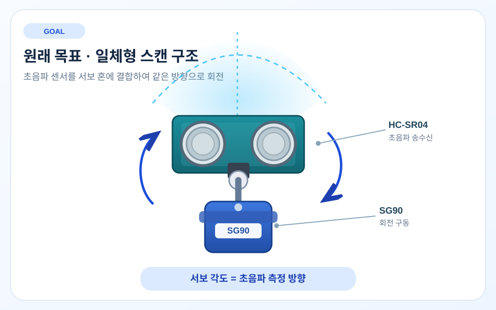
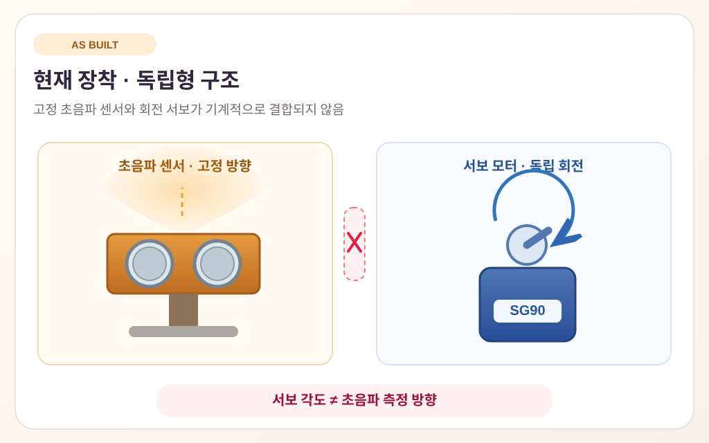
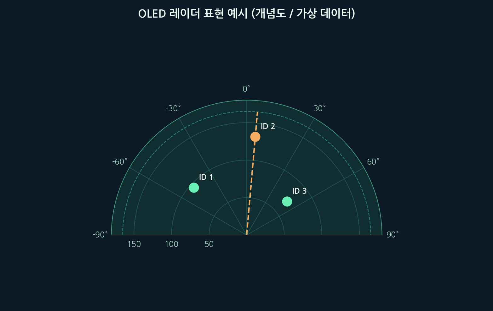

# 2026-11-25 발표용 핵심 아이디어 및 센서 구조 비교

> **발표 프로젝트:** Cortex-M4F 기반 실시간 다중 표적 탐지·추적 및 방공 시뮬레이션 시스템  
> **개발 환경:** NXP S32K144EVB-Q100 / S32 Design Studio  
> **발표 예정:** 2026-12-16(수), 팀당 10분  
> **문서 성격:** 발표 초안 / 개념 설계와 실물 검증 상태를 분리해 기술  
> **그림:** 이 폴더의 자체 제작 설명용 SVG. 실제 촬영 사진이나 확정된 기구 설계도가 아님.

## 1. 한 문장 프로젝트 소개

**"서보와 초음파 센서로 주변을 스캔하여 변화하는 표적을 탐지하고, 여러 표적의 ID를 유지하면서 사용자가 선택한 표적의 방향을 스텝 모터로 가리키는 MCU 기반 레이더 시뮬레이션 시스템"**

### 발표에서 강조할 핵심 세 가지

1. **거리 측정 → 배경 제거 → 표적 검출:** 초음파 거리값을 각도별로 정리하여 단순 장애물 감지보다 한 단계 높은 탐지 흐름 구현.
2. **다중 표적 ID 추적:** 기본 시연 목표 **3개**, 내부 구조 최대 **5개**. 교차·가림 구간에서 ID 유지가 어려울 수 있다는 한계 포함.
3. **입력·표시·제어 통합:** ADC로 표적을 선택하고 OLED/LCD로 표시하며 Stepper로 조준 방향을 나타내고 LED로 가상 발사(표시만)를 시뮬레이션.

## 2. 서보–초음파 구조 비교 — 핵심 발표 그림

| **원래 목표 — 일체형 스캔 구조** | **현재 장착 — 독립형 구조** |
|:---:|:---:|
|  |  |
| **서보 각도 = 센서 관측 방향** | **서보 각도 ≠ 센서 관측 방향** |
| 거리와 각도를 묶어 `(θ, d)`를 얻을 수 있음 | 고정 센서는 거리 `d`만 측정하고 방향 연동이 없음 |

**발표용 설명:** 원래 설계는 서보 모터 위에 초음파 센서를 장착하여 회전 각도마다 거리를 측정하는 구조입니다. 그런데 현재 실물 장착에서는 초음파 센서와 서보가 독립적이므로, **서보의 명령 각도를 초음파 거리 측정값의 관측 각도라고 주장할 수 없습니다.** 이 점을 실제 시스템 통합의 설계 과제로 관리하고 있습니다.

그림을 슬라이드에 개별 삽입하려면:

- [원래 목표 그림 — SVG 원본](images/20261125_goal_coupled_scan.svg)
- [현재 장착 구조 그림 — SVG 원본](images/20261125_actual_separate_mount.svg)

> **구조 판단:** 2D 실물 레이더를 완성하려면 초음파 센서를 서보 회전축과 결합하고 기계적 영점/오프셋을 보정해야 함. 결합이 어렵다면 실제 센서 실험은 1D 거리 측정으로 제한하고 2D 추적은 가상 센서·C 시뮬레이션으로 별도 검증.

## 3. 시스템 전체 개념도

*출처: 저장소 기존 자체 개념도 `docs/images/01_system_architecture.png`. 최종 실제 배선도와 구분.*

**파이프라인:** 초음파 거리 측정 + 서보 방향 → 필터·배경 차분 → 표적 후보 군집화 → ID 추적 → OLED/LCD 표시 + ADC 선택 → Stepper 방향 제어 → LED 가상 발사.

## 4. 현재 구현 및 확인 결과 — 발표에서 사실과 목표 구분

| 기능 | 구현/실험 상태 | 발표 문구 |
|---|---|---|
| MCU 클록 / LPIT / GPIO / ADC | 실물 기본 동작 확인 | "보드 주변장치 기본 검증 완료" |
| 초음파 센서 / OLED / LCD | 실물 기본 동작 확인 | "거리 측정·출력 동작 확인" |
| SG90 Servo | 왕복 동작 관찰, 실제 각도 오차 미측정 | "PWM 위치 명령에 반응하며 복귀 확인, 각도 보정 필요" |
| Stepper | 왕복 동작 관찰, 실제 100° 이동량 미측정 | "단독 각도 구동 확인, 실각도 검증 진행 예정" |
| 표적 검출·추적 C 코드 | 구현 및 PC 기반 가상 시나리오 실험 | "시뮬레이션에서 동작 검증, 실물 2D 통합 전" |
| 다중 표적 결과 | 이동 2개 표적 F1 92.86%, ID switch 1회 **시뮬레이션** | "합성 데이터 기반 지표이며 실물 성능 아님" |
| 실제 2D 레이더 통합 | 물리 방향 결합 제약으로 미검증 | "기계 구조 정합 및 통합 검증 과제" |

**현재 보존된 Bring-up 버전:** [`snapshot/20261125-peripheral-bringup`](https://github.com/ulhannnah/MP_TerP/tree/snapshot/20261125-peripheral-bringup).  
**이후 개발 브랜치:** [`jun_GPT`](https://github.com/ulhannnah/MP_TerP/tree/jun_GPT).

## 5. 발표용 설명 대본 (약 40~60초 분량)

> "저희 프로젝트는 S32K144 MCU의 주변장치를 이용한 다중 표적 추적 레이더 시뮬레이션입니다. 단순히 초음파 센서로 거리를 표시하는 것을 넘어, 배경과 다른 관측값을 검출하고 여러 표적의 ID를 유지한 뒤 선택한 표적 방향으로 스텝 모터를 구동하는 것을 목표로 합니다.
>
> 왼쪽 그림은 원래 계획한 기구 구성으로, 초음파 센서가 서보와 함께 회전하여 각도와 거리를 동시에 얻을 수 있습니다. 오른쪽은 현재 실물의 독립 장착 형태입니다. 현재는 서보 각도가 센서 방향을 뜻하지 않으므로 이 측정으로 2D 표적 위치를 계산할 수 없습니다. 지금까지는 서보·초음파·Stepper와 화면 등 주변장치의 기본 구동을 확인했고, 표적 검출·추적 알고리즘은 PC 시뮬레이션에서 검증했습니다. 다음 단계는 센서의 방향 정합과 전체 동작 통합입니다."

## 6. 슬라이드 구성 제안 (10분 발표 기준)

| 슬라이드 | 제목 | 핵심 그림/내용 |
|---|---|---|
| 1 | 표지 | 프로젝트명·팀·수업명 |
| 2 | 목표 및 차별점 | 단순 초음파 측정 vs 표적 ID 추적 + 조준 |
| 3 | 하드웨어 구조 | **이 문서의 두 구조 비교 SVG** + 실제 기구 사진 추가 예정 |
| 4 | 전체 시스템 블록도 | **기존 아키텍처 그림** |
| 5 | 알고리즘 | 배경 차분·후보 군집·다중 ID 매칭 |
| 6 | 주변장치 구현 | PWM / FTM Capture / LPIT / ADC / OLED / LCD |
| 7 | 검증 결과 | 실물 모듈 동작 vs PC 시뮬레이션 수치 구분 |
| 8 | 제한점 및 개선 | 실제 방향 정합, SG90 각도 오차, 표적 분리 |
| 9 | 시연 | 가능해진 실제 동작 영상과 코드 |
| 10 | 결론 및 참고문헌 | 확인된 성과와 후속 계획 |

※ 공식 발표 요구 항목인 **팀 구성·역할 분담, 일정, 회로도, 소프트웨어 흐름도, 결과, 참고문헌, 소스/시연 영상**도 최종 PPT에 반영해야 한다. 이 문서는 슬라이드 원고의 시작점이며 PPT 완성본은 아니다.

## 7. 그림·관련 자료 링크

### 바로 재사용 가능한 저장소 자료

- [그림: 목표 일체형 스캔 구조](images/20261125_goal_coupled_scan.svg)
- [그림: 현재 독립형 장착 구조](images/20261125_actual_separate_mount.svg)
- [그림: 전체 시스템 아키텍처](../docs/images/01_system_architecture.png)
- [그림: 시스템 제어 흐름도](../docs/images/02_control_flow.png)
- [그림: 개발 일정](../docs/images/04_development_schedule.png)
- [그림: 공식 평가 배점](../docs/images/05_rubric.png)
- [2026-11-25 주변장치 실물 검증 기록](../docs/20261125_전체_주변장치_구동_검증_및_SG90_관찰_기록.md)
- [표적 3개 기본·5개 확장 운용 정책](../docs/20261124_레이더_3표적_기본운용_5표적_확장정책.md)
- [프로젝트 종합 설계 문서](../docs/MCU_Radar_Term_Project_2026.md)
- [과제 공지 및 PPT 평가 기준 원본](../docs/마이크로프로세서%20설계실험_Term_project_2026.pdf)

### 기술 참고 링크

- [NXP S32K144EVB-Q100 보드 관련 자료](https://www.nxp.com/products/processors-and-microcontrollers/s32-automotive-platform/s32k-auto-general-purpose-mcus/s32k144-q100-evaluation-board-for-automotive-general-purpose%3AS32K144EVB)
- [NXP S32K1xx Cookbook (AN5413)](https://www.nxp.com/docs/en/application-note/AN5413.pdf)

### 발표 자료 개선 예정

- [ ] 실제 센서·서보의 물리 배치 사진 촬영 및 교체/추가
- [ ] 일체형 거치대를 설치한다면 실제 장착 사진과 각도 기준 측정값 추가
- [ ] 실물 각도 검증표, 주변장치 기능 증빙 사진, 작동 시연 영상 추가
- [ ] 팀원 역할 분담과 최종 회로도 확정
- [ ] PPT 또는 PDF 발표본 제작

*이 문서의 구조 비교 그림은 사용 편의를 위해 직접 제작한 편집 가능한 벡터 이미지다. 센서/모터 크기는 실제 규격의 축척이 아니며, 실제 사진을 대체하는 증거로 사용하지 않는다.*
