# 2026-11-25 MP_TerP 시스템 전체 아키텍처와 하드웨어·소프트웨어 블록 다이어그램

> **프로젝트:** S32K144 Cortex-M4F 기반 다중 표적 탐지·추적 레이더 시뮬레이션  
> **기준:** GitHub `jun_GPT`, 문서 작성 전 소스 HEAD `ff0c3c24dde9b30e9742685f8c92f5a00dec9405`  
> **작성일:** 2026-11-25 (KST)  
> **용도:** 발표 슬라이드 초안 / 전체 시스템 설계 기준 문서  
> **검증 수준:** 주변장치 기본 구동 확인, C 알고리즘/가상 센서 기능 분리 검증. **보드 부재로 새로운 하드웨어 검증 미실시.**  
> **표기 원칙:** 그림에 나타난 최종 시스템 흐름이 곧 실물 End-to-End 동작 완료를 의미하지 않는다.

> **2026-11-25 구현 갱신:** 이 문서의 일부 "Stage 5 App 설정 누락 / 조준 스냅샷 미구현" 설명은 **이전 커밋 기준 문제점**을 기록한 것이다. 현재 `jun_GPT`에는 120° `AppConfig` 기본 프로파일, 수동 Stepper 90° 중심 확인, IRQ/LCD 초기화 연결, 버튼 순간 표적 각도 고정 및 이동 완료 후 LED 표시 FSM이 추가됐다. [변경 내역·CI PASS 문서](../docs/20261125_Stage5_통합프로파일_조준스냅샷_CI검증.md)를 최신 상태의 기준으로 삼을 것. **새 Stage 5 하드웨어 구동은 미검증이며 LCD 전송은 여전히 Blocking**이다.

> **LCD 런타임 동작 업데이트 (2026-11-25):** 이 문서의 기존 LCD Blocking 진단은 소스 개선 전 기준이다. 현재 `jun_GPT`에는 **Stage 5 전용 HD44780 큐 송신/1ms Tick 상태 머신**이 추가됐고 [GitHub Actions에서 호스트 테스트 PASS](https://github.com/ulhannnah/MP_TerP/actions/runs/45625610566)를 확인했다. 기본 Bring-up의 동기 LCD 출력과 초기화 시 Blocking은 유지된다. [기술 설명 및 실물 확인 항목](../docs/20261125_LCD_비차단_큐기반_전송_및_CI_검증.md).

## 0. 한눈에 보는 현재 위치

**최종 목표:** 초음파 센서의 각도별 거리를 확보해 정적 배경과 표적을 구분하고, 기본 3개/확장 5개 표적의 ID를 유지한다. ADC로 표적을 선택하고 Stepper 방향 제어와 OLED/LCD, LED 가상 발사를 연결한다.

**현재 확보한 것:** S32K144의 기본 주변장치 동작, SG90·Stepper 독립 구동, 초음파 고정 방향 거리 측정, 별도로 작성된 `App`·검출·추적 C 코드 및 PC 가상 시나리오. **실제 2D 레이더 통합은 아직 확인되지 않았다.**

**핵심 제약:** 현재 보고된 장착 구조에서는 초음파 센서의 관측 방향이 서보 각도와 연결되지 않는다. 기계적 방향 결합/실측 방향 입력 없이 `(angle, range)`를 실물 2D 관측값으로 해석하지 않는다.

---

## 1. 시스템 최상위 기능 블록도 — 최종 목표

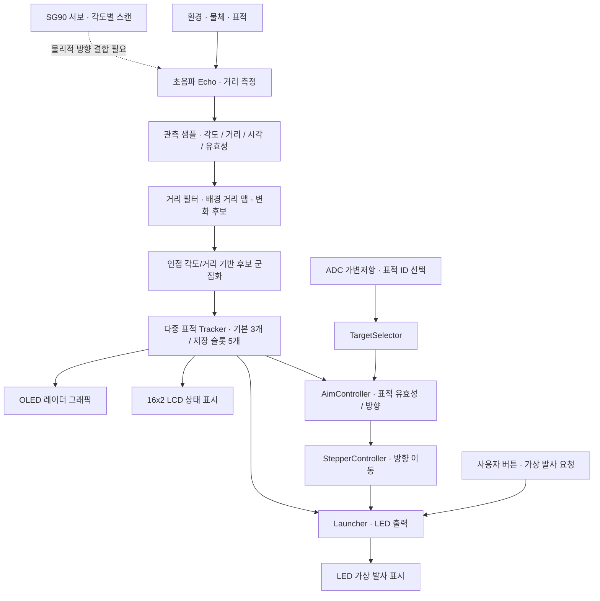

- **실선:** 최종 소프트웨어 기능상 데이터/제어 관계를 설명하는 개념 연결.
- **점선:** 2D 레이더를 위한 **기계적 방향 정합 조건**. 현재 실물에서 아직 확보되지 않음.
- **중요:** `App`에서 실제 구현한 `AimController`는 선택 표적을 계속 따라가도록 명령한다. 버튼 순간 방향을 고정하는 **조준 스냅샷 FSM은 아직 구현된 상태가 아니다.**
- **LED는 실제 발사 장치가 아닌 표시용 시뮬레이션**으로만 사용한다.

### 1.1 물리적 장착 조건

| 원래 목표 | 현재 보고된 실물 구조 |
|---|---|
| 센서가 SG90 회전축 위에 결합 | 초음파 센서 고정, SG90 별도 배치 |
| `theta` = 센서 실제 관측 방향 (영점 보정 후) | Servo PWM 명령은 센서 관측 방향을 뜻하지 않음 |
| 방향+거리로 2D 관측 가능 | 거리 단독 측정과 독립 Servo 제어만 가능 |

| **원래 목표 — 결합형** | **현재 장착 — 독립형** |
|:--:|:--:|
| 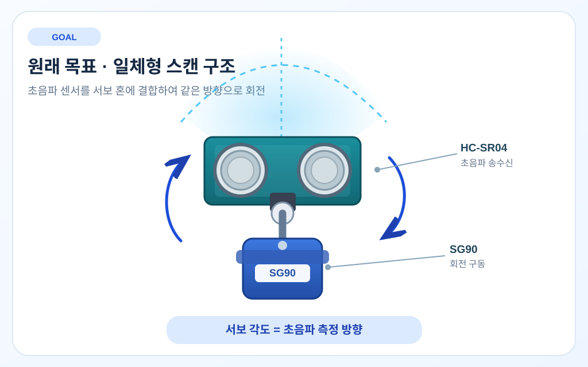 | 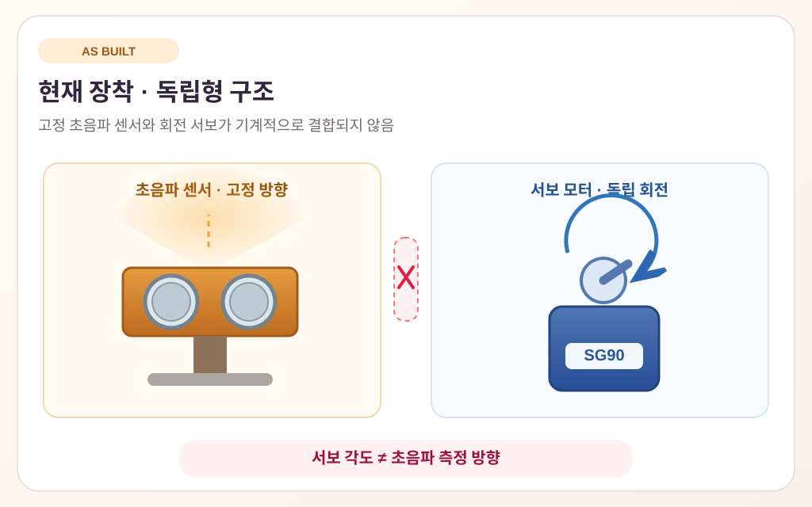 |

그림은 발표용 개념도이며 실제 장착 사진이 아니다.

---

## 2. 하드웨어 블록도 — S32K144 자원 및 핀

아래 핀은 **현재 `board_config_user_template.c`의 코드 배치** 기준이다. 실제 보드 쉴드/배선과 최종 회로도 확정 여부를 별도로 확인해야 한다.

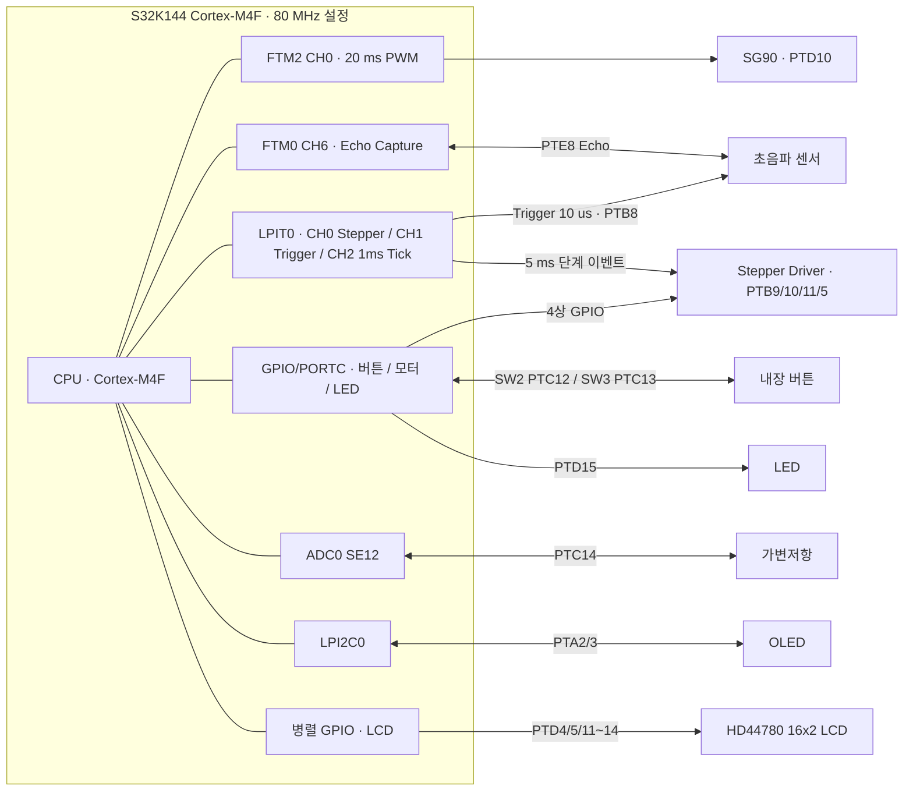

### 2.1 자원 배치 표

| 기능 | 소프트웨어 모듈 | 설정 자원 | 물리적으로 확인할 점 |
|---|---|---|---|
| SG90 위치 제어 | `servo.c` | PTD10, FTM2_CH0, 50 Hz PWM | 출력 펄스 실측, PWM-실각도 관계 |
| 초음파 거리 | `ultrasonic_port_s32k144.c` | PTB8 Trigger, PTE8 FTM0_CH6 Echo | 전압 레벨, Capture IRQ, 정확도 |
| 시스템 시간 | `timer_manager.c` | LPIT0 CH2, 1 ms | Tick 증가, ISR 지연 |
| Trigger 펄스 | `timer_manager.c` | LPIT0 CH1, 원샷 10 μs | High 폭 |
| Stepper | `step_motor.c` + `stepper_controller.c` | PTB9/10/11/5 + LPIT0 CH0 | 출력축 감속비·원점·탈조 |
| SW2/SW3 | `gpio_io.c` | PTC12 / PTC13 | 현재 `main_all_test.c`에서 독립 시험 |
| ADC 선택 | `adc_channel.c` | PTC14, ADC0_SE12 | ADC 범위 / 선택 히스테리시스 |
| OLED | `oled.c`/포트/렌더러 | LPI2C0, PTA2/3 | 버스 지연 |
| 텍스트 LCD | `lcd_hd44780.c` | PTD4/5, PTD11~14 | 현재 지연 구현의 블로킹 |
| LED | `gpio_io.c` + `launcher.c` | PTD15 | 가상 이벤트 표현만 |

**전원 설계:** MCU GPIO가 모터 전원을 직접 공급하지 않는다. 모터 전원과 드라이버, 공통 GND, 센서 Echo 입력 전압 허용치를 실제 배선에서 확인해야 한다.

---

## 3. 펌웨어 소프트웨어 계층도 — 실제 코드 파일과 대응

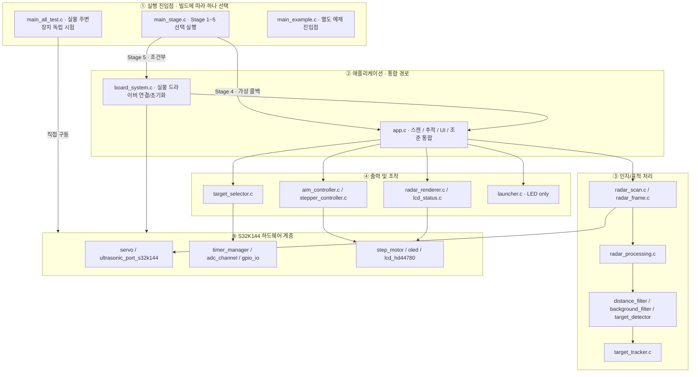

- 위 그림의 선은 `include` 관계가 아니라 **기능적 호출/의존 관계를 요약한 것**이다.
- `main_all_test.c`는 `BoardSystem`의 `App` 전체 파이프라인을 실행하지 않고, 각 드라이버를 독립적으로 점검한다.
- `main_stage.c` Stage 4는 실제 C `App`과 **가상 Echo/서보**를 결합한다. 실제 주변장치가 작동하는 시험이 아니다.
- Stage 5는 `MP_TERP_CONFIRM_COUPLED_GEOMETRY` 조건이 걸려 있고 아직 실물로 검증되지 않았다.

### 3.1 디렉터리 역할

```text
MP_TerP/
├── src/
│   ├── main_all_test.c        # 현재 실물 Bring-up 진입점
│   ├── main_stage.c           # 단계별/가상/전체 보드 모드
│   ├── board_config_user_template.c
│   ├── board_system.c         # 드라이버와 App 간 연동
│   ├── app.c                  # 최종 전체 응용 통합
│   ├── radar_*.c              # Scan/Frame/Processing/Renderer
│   ├── target_*.c             # Detector/Tracker/Selector
│   ├── aim_controller.c
│   ├── launcher.c
│   ├── servo.c / stepper_controller.c / ...
│   └── header/               # 설정과 공개 API
├── tests/                     # PC 호스트 C 단위/통합 테스트
├── sim/                       # Python 기반 가상 시나리오 + C 소스
├── docs/                      # 하드웨어/검증/보정 기록
└── presentation/              # 발표 Markdown과 개념도
```

---

## 4. 레이더 데이터 파이프라인 — 소스 단위

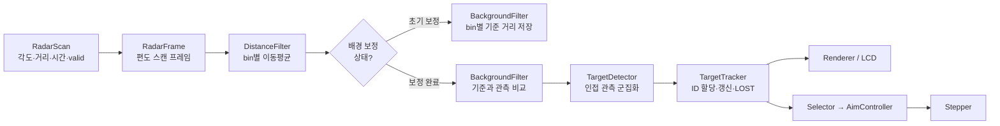

**현재 C 코드 동작 요약**

1. `RadarScan_Update`: 서보 각도 명령 → 안정화 대기 → 초음파 트리거 → Echo 완료/Timeout 확인.
2. `RadarScan_TakeSample`: `RadarSample{angle_mdeg, distance_mm, timestamp_ms, valid}` 획득.
3. `RadarFrame_Add`: 해당 각도 bin에 삽입, 편도 끝점에서 프레임 완료 처리.
4. `RadarProcessing_ProcessCompleted`: bin별 필터 갱신 후 처음 한 프레임을 배경 보정에 사용. 이후 차분으로 전경 후보를 판정.
5. `TargetDetector_Detect`: 인접 각도/거리 기준으로 샘플 그룹을 후보 하나로 병합.
6. `TargetTracker_Update`: 최근접 각도/거리 게이팅과 슬롯 상태(NEW/TRACKING/LOST) 갱신.
7. `App_Update`: ADC로 ID를 선택하고, 목표 유효성/조준 상태에 따라 OLED·LCD·Stepper·LED를 갱신.

### 4.1 데이터 단위

| 데이터 | 대표 내용 | 생산 → 소비 |
|---|---|---|
| `RadarSample` | 명령 각도 [mdeg], 거리 [mm], 타임스탬프 [ms], valid | Scan → Frame |
| `RadarFrame` | 각도 bin별 샘플, present, 수신 수, frame 번호 | Frame → Processing/Renderer |
| `TargetCandidate` | 그룹 평균 각도·거리·시간, 샘플 수 | Detector → Tracker |
| `RadarTarget` | ID, 각도, 거리, last_seen, miss_count, state | Tracker → Aim/UI |
| `ServoCalibrationPoint` | 명령 각도 [mdeg], PWM High [μs] | Board Config → Servo PWM |
| `Launcher` 내부 플래그 | 버튼 요청, 표시 활성, 디바운스 | App → LED |

**중요한 미구현/제약:** 표적의 예측 위치나 속도 기반 고급 추적이 모두 구현된 것은 아니다. 현재 `target_tracker.c`는 주로 각도·거리 최근접 매칭이고, 근접·교차·가림에서 후보 병합과 ID 전환이 나타날 수 있다.

---

## 5. 스캔 FSM 및 인터럽트/데이터 타이밍

### 5.1 실제 `radar_scan.c` FSM

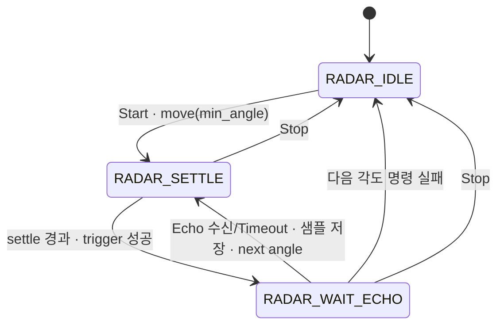

### 5.2 시간 흐름 / ISR 역할

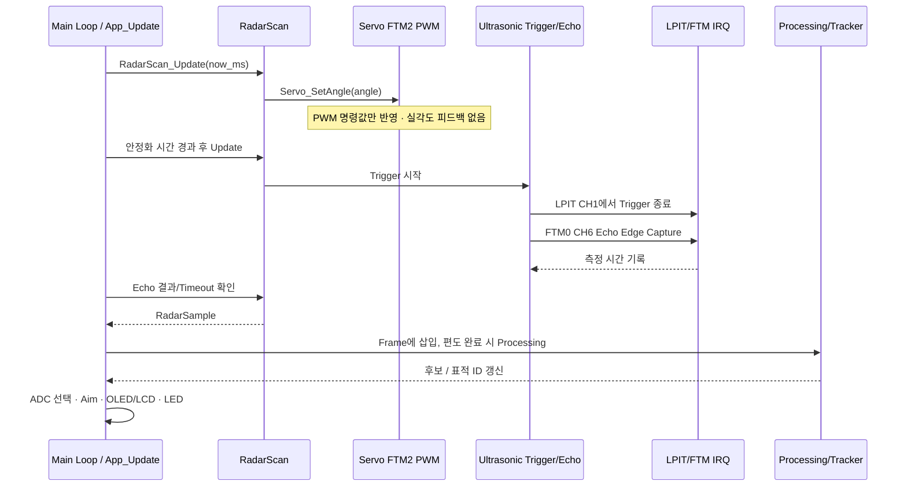

**실시간성 주의:** `lcd_hd44780.c`의 `pause_us`는 현재 보드 템플릿의 `lcd_delay_us`를 경유해 **밀리초 단위 바쁜 대기**를 한다. ISR 타임스탬프 처리와 별개로 Main Loop 갱신 지연이 커질 수 있으므로 통합 전에 수정/계측이 필요하다.

---

## 6. SG90 120° 보정 구조 — 최근 `jun_GPT` 코드

### 6.1 제어 경로

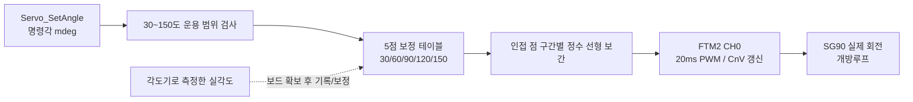

| 명령 각도 | 초기 HIGH 시간 | 검증 단계 |
|---:|---:|---|
| 30° | 1157 μs | 미측정 초기 맵 |
| 60° | 1329 μs | 미측정 초기 맵 |
| 90° | 1500 μs | 미측정 초기 맵 |
| 120° | 1671 μs | 미측정 초기 맵 |
| 150° | 1843 μs | 미측정 초기 맵 |

- 보정 API: `Servo_SetCalibration` / `Servo_ClearCalibration` / `Servo_GetPulseUs`.
- 보드 프로파일: `board_config_user_template.c`에서 5점 값 지정. `BoardSystem` 및 Stage 2/Bring-up에서 설정값을 적용하도록 연결.
- SW3 시험: 90° 초기화 → 30 → 60 → 90 → 120 → 150 → 90° (각 지점 약 2초 대기).
- **실물 보정값이 아니므로 각도 정확도 향상은 아직 주장할 수 없음.** 엔코더나 외부 각도 센서가 없는 개방루프 구조.
- 상세 실험표: [SG90 5점 PWM 각도 보정 문서](../docs/20261125_SG90_120도_5점_PWM각도보정_실험계획.md).

---

## 7. 실제 빌드/실행 모드 — 혼동 방지

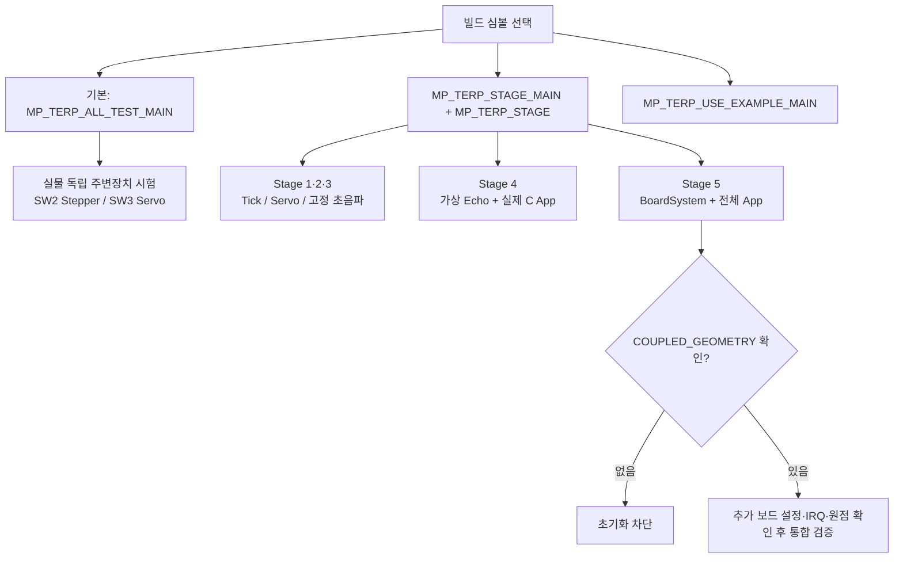

| 모드 | 기능 | 상태/제약 |
|---|---|---|
| 기본 `main_all_test.c` | LED·ADC·OLED·LCD·고정 Echo·SW2 Stepper·SW3 SG90 | 기본 주변장치 개별 구동 확인. 레이더 Tracker는 **실행 안 함** |
| Stage 1~3 | 개별 클록/Tick, Servo, 고정 센서 | 개별 개발/진단 모드 |
| Stage 4 | 가상 센서 + 실 C App/Tracker | **합성 데이터 시뮬레이션**. 주변장치 실물 검증 아님 |
| Stage 5 | 실물 BoardSystem + App | 조건부 실행 경로. **아직 전체 실물 실행 검증 아님** |
| 별도 PC tests/sim | Mock C 단위/통합 테스트, Python 합성 시나리오 | 임베디드 실측과 성능을 구분해야 함 |

### 7.1 Stage 5 진입 전 구조적 부족 사항

1. `board_config_user_template.c`는 현재 `cfg->application`의 스캔 각도·주기·임계값·표시 설정을 채우지 않는다. `BoardSystem_Init`가 `App_Init`을 호출하는 현재 구조상 이 설정 없이 정상 통합 초기화를 기대할 수 없다.
2. 전체 보드 경로에서는 `BoardSystem_Init`이 단독 시험과 동등한 방식으로 FTM Echo/PORTC NVIC을 활성화하는지 확인/보완이 필요하다. Stage 5 IRQ 벡터 연결도 분리된 편이다.
3. `StepperController_SetHome`가 실물 기준점으로 호출되어야 `AimController`의 이동 명령이 의미 있게 동작한다. 자동 물리 원점 센싱 기능은 없다.
4. Servo 보정점 실측, 초음파 관측 방향 결합/각도 동기화가 필요하다.
5. LCD Blocking 지연, 초음파 샘플 손실 가능성, 스캔 및 표시 주기 계측이 필요하다.
6. 설계 설명에는 **버튼 순간 선택 표적 각도 고정 → 조준 완료 후 LED**가 포함되어 있으나 현재 `App/AimController/Launcher` 코드는 **선택 표적을 계속 따라가고 그 시점의 valid/aimed로 LED를 허용**한다. 버튼 시점 스냅샷 정책은 별도 FSM으로 구현해야 한다.

---

## 8. 구현 상태와 발표용 표현

| 항목 | 구현 | 확인된 것 | 아직 확인하지 못한 것 |
|---|---|---|---|
| Servo/Stepper 독립 구동 | O | 이전 보드에서 구동 및 복귀 관찰 | 최신 SG90 5점 보정판 실물 결과 |
| LPIT·ADC·GPIO·기본 표시 | O | 개별 기본 작동 경험 | 최종 App 상태에서 장시간 동시 동작 |
| 초음파 거리 | O | 고정 방향 측정 | 서보 각도와 물리 결합된 거리값 |
| 필터/배경·표적 검출 | O (C) | PC 가상 시나리오 | 실제 2D 측정 데이터 |
| 다중 표적 Tracker | O (C) | 합성 시나리오 일부 | 실물 3개 동시 추적 / 교차·가림 정량 결과 |
| ADC 선택·Aim·LED | O (C) | 모듈 구현 | 실제 전체 앱 모션/버튼 시나리오 |
| Stage 5 하드웨어 통합 | 경로 존재 | 소스 구조 존재 | 정상 초기화, 인터럽트/원점, 실물 End-to-End |
| SG90 5점 보간 | 구현 | 코드 구조 점검/보간 계산 확인 | 실제 정밀도 개선, S32DS 실행 |

기존 시뮬레이션의 이동 2표적 **F1 92.86%, ID Switch 1회**는 합성 센서 조건의 결과이며, 실제 보드의 2D 레이더 성능이나 구현 완료를 의미하지 않는다.

---

## 9. 보드 없이 진행할 수 있는 작업

| 우선순위 | 작업 | 완료 기준 / 산출물 |
|---|---|---|
| P0 | 최종 App 파라미터 설정 완성 | 현재 모드와 분리된 Stage 5용 보드 프로파일; 유효성 단위 테스트 |
| P0 | 서보·초음파 **기구 방향 연동 방식 결정** | 센서 회전 지그 설계 또는 실물 1D/가상 2D 시연안 확정 |
| P1 | 조준 스냅샷 FSM 정의 | 요청 시 ID·시각·각도 복사 → 목표 고정 → 완료/오류/표시 상태 |
| P1 | LCD 지연 최소화 및 UI 분리 | 디스플레이 갱신 중 메인 루프 비차단/지연 수치 |
| P1 | Servo 5점 테이블 호스트 회귀 테스트 | 호스트 GCC 테스트 PASS 로그; 보정 테이블 입력 안전성 |
| P1 | Stage 4/PC 통합 시나리오 | 배경 보정, 표적 1~3, LOST, ID 변경, 버튼 요청 |
| P2 | DSP/FPU/타이밍 비교 실험 설계 | DWT 등 보드 복귀 시 계측할 항목 정의 |

**보드 재확보 후 검증 순서:** PWM 20ms/펄스 실측 → SG90 5점 실각도 확인 → Stepper 실제 회전각 및 기준점 → 초음파 방향 정합 → Stage 5 전체 초기화/IRQ → 1개 표적 → 2~3개 추적 → 사용자 선택·Stepper·LED → 지연/오차 측정.

---

## 10. 발표 슬라이드로 분리할 때

- **슬라이드 A — 시스템 개요:** 1장의 최상위 기능 블록도와 목표·현재를 구분하는 한 문장.
- **슬라이드 B — 하드웨어 구성:** 2장의 S32K144 블록도, GPIO·FTM·LPIT 채널표 및 실제 배선 사진(추가 예정).
- **슬라이드 C — 소프트웨어 아키텍처:** 3장의 계층도, `main_all_test` vs `App` 구분.
- **슬라이드 D — 핵심 알고리즘:** 4장의 레이더 데이터 파이프라인 및 ID 상태.
- **슬라이드 E — 실시간 제어:** 5장의 스캔 FSM/IRQ 순서도.
- **슬라이드 F — Servo 보정·시연:** 6장의 PWM 보정 구조와 5점 기준표.
- **슬라이드 G — 성과와 한계:** 8장의 검증 상태표 및 9장의 다음 단계.

**재사용 이미지:** 기존 아키텍처 개념도 [01_system_architecture.png](../docs/images/01_system_architecture.png), [02_control_flow.png](../docs/images/02_control_flow.png), [결합형 센서 개념도](images/20261125_goal_coupled_scan.svg), [독립형 센서 개념도](images/20261125_actual_separate_mount.svg).

### 기존 시스템 개념도

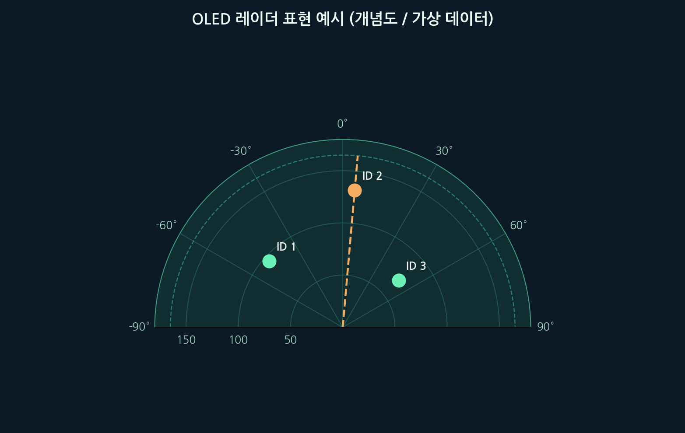

---

## 11. 소스 근거 및 관련 문서

**실제 소스 확인:** `src/main_all_test.c`, `src/main_stage.c`, `src/board_config_user_template.c`, `src/board_system.c`, `src/app.c`, `src/radar_scan.c`, `src/radar_frame.c`, `src/radar_processing.c`, `src/servo.c`, `src/aim_controller.c`, `src/stepper_controller.c`, `src/target_detector.c`, `src/target_tracker.c`, `src/launcher.c`, `src/ultrasonic_port_s32k144.c`, `src/timer_manager.c` 및 연관 헤더.

**설계/시험 문서:** [프로젝트 종합 설계](../docs/MCU_Radar_Term_Project_2026.md), [SG90 120° 5점 실험 계획](../docs/20261125_SG90_120도_5점_PWM각도보정_실험계획.md), [주변장치 실물 기본 검증 기록](../docs/20261125_전체_주변장치_구동_검증_및_SG90_관찰_기록.md), [기본 3/확장 5개 표적 정책](../docs/20261124_레이더_3표적_기본운용_5표적_확장정책.md), [발표용 센서 장착 비교](20261125_발표_핵심아이디어_및_센서구조_비교.md).

**버전 관리:** 개발은 `jun_GPT`에서 지속. 기존 기준점 `snapshot/20261125-peripheral-bringup`은 수정하지 않는다.

> GitHub Markdown의 `mermaid` 코드블록은 웹에서 바로 블록 다이어그램/시퀀스/상태도로 렌더링할 수 있다. 이 문서의 Mermaid 코드는 재사용·수정 가능한 **다이어그램 원본**이며 PNG나 실제 PCB 회로도가 아니다.
